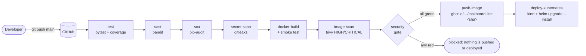
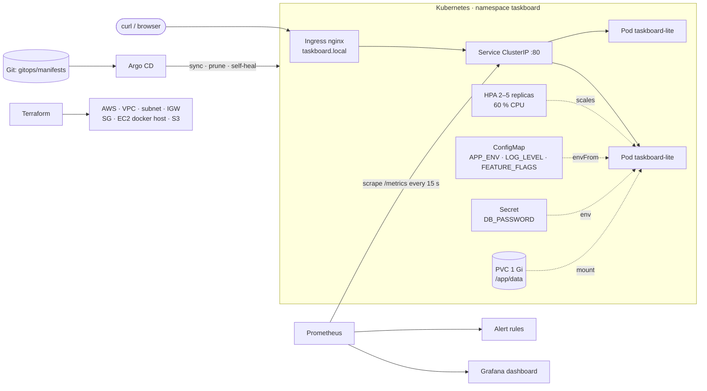

<div align="center">

# TaskBoard Lite

### A small Flask task board carried through the complete DevOps toolchain

Tests · DevSecOps gates · Docker · GitHub Actions · GHCR · Terraform on AWS · Kubernetes · Helm · Ingress · HPA · Prometheus + Grafana · GitOps · Troubleshooting lab


**Student:** Vivek Singh Solanki &nbsp;·&nbsp; **Roll number:** 24bcs10338 &nbsp;·&nbsp; **Session 21: Final DevOps Capstone Project**

</div>

---

## Table of contents

1. [What this project is](#1-what-this-project-is)
2. [Architecture](#2-architecture)
3. [Repository layout](#3-repository-layout)
4. [Quick start](#4-quick-start)
5. [The application](#5-the-application)
6. [Testing](#6-testing)
7. [Docker](#7-docker)
8. [CI/CD pipeline](#8-cicd-pipeline)
9. [DevSecOps](#9-devsecops)
10. [Infrastructure as Code (Terraform on AWS)](#10-infrastructure-as-code-terraform-on-aws)
11. [Kubernetes and Helm](#11-kubernetes-and-helm)
12. [Observability](#12-observability)
13. [GitOps](#13-gitops)
14. [Troubleshooting lab](#14-troubleshooting-lab)
15. [Evidence (screenshots)](#15-evidence-screenshots)
16. [Grading rubric map](#16-grading-rubric-map)
17. [Design decisions and trade-offs](#17-design-decisions-and-trade-offs)
18. [Lessons learned](#18-lessons-learned)

---

## 1. What this project is

TaskBoard Lite is a deliberately small task-management web application. The application is tiny on purpose: the point of the capstone is everything *around* it. One commit travels from a laptop through automated tests, four security scanners and a security gate, into a hardened container image in GitHub Container Registry, onto cloud infrastructure provisioned by Terraform and into a Kubernetes cluster managed by Helm, where it is autoscaled, scraped by Prometheus, graphed in Grafana and kept in sync by Argo CD.

| Layer | What is in this repository |
|---|---|
| **Application** | Python 3.12 / Flask 3.1, server-rendered responsive UI, 6 REST endpoints, SQLite storage, `/health`, `/ready`, `/metrics` |
| **Testing** | 17 pytest cases, 92 % coverage, isolated temp database per test |
| **Containers** | Multi-stage Alpine image (23.7 MB), non-root `uid 10001`, `HEALTHCHECK`, docker compose stack (app + Prometheus + Grafana) |
| **CI/CD** | GitHub Actions, 9 chained jobs: test → SAST → SCA → secret scan → build → image scan → security gate → push to GHCR (tag = commit SHA) → deploy to a kind cluster with Helm |
| **DevSecOps** | Bandit, pip-audit, gitleaks, Trivy (fails on HIGH/CRITICAL), SARIF upload to the GitHub Security tab |
| **Infrastructure** | Terraform 1.6+ / AWS provider 6.x: VPC, public subnet, IGW, route table, security group, EC2 Docker host (AL2023, IMDSv2, encrypted disk), private versioned S3 bucket |
| **Kubernetes** | Namespace with Pod Security labels, ConfigMap, Secret, PVC, Deployment (2 replicas, 3 probes, restricted securityContext), ClusterIP Service, NGINX Ingress, HPA 2 → 5 pods at 60 % CPU |
| **Helm** | Chart `helm/taskboard-lite` with `values.yaml`, `values-prod.yaml`, helpers, `NOTES.txt`, checksum-based config rollouts |
| **Observability** | 3 custom Prometheus metrics, ServiceMonitor + PrometheusRule for kube-prometheus-stack, provisioned Grafana dashboard, 4 alert rules |
| **GitOps** | Argo CD `Application` with automated sync, prune and self-heal over a kustomize overlay |
| **Troubleshooting** | 4 intentionally broken manifests, each diagnosed and fixed with `kubectl` (ImagePullBackOff, empty endpoints, CreateContainerConfigError, failing readiness probe) |

Every stage was executed for real (minikube on Colima, Terraform against a live AWS account, `act` for the pipeline). The complete terminal output is preserved in [docs/EXECUTION-LOG.md](docs/EXECUTION-LOG.md) and the screenshots in [screenshots/](screenshots/).

---

## 2. Architecture

### Delivery pipeline



### Runtime topology



---

## 3. Repository layout

```text
.
├── application/            app.py (Flask app, metrics, SQLite store), tests/, requirements*.txt, pytest.ini
├── docker/                 Dockerfile (multi-stage, Alpine, non-root), docker-compose.yml (app + Prometheus + Grafana)
├── .github/workflows/      final-pipeline.yml: the 9-job CI/CD + DevSecOps pipeline
├── security/               bandit.yaml, .gitleaks.toml, trivy.yaml, .trivyignore, README.md (how every scanner is wired)
├── terraform/              versions.tf, variables.tf, main.tf, outputs.tf, terraform.tfvars.example, README.md
├── kubernetes/             plain manifests: namespace, configmap, secret, pvc, deployment, service, ingress, hpa
├── helm/taskboard-lite/    Chart.yaml, values.yaml, values-prod.yaml, templates/ (+ NOTES.txt, _helpers.tpl)
├── monitoring/             prometheus.yml, alerts.yml, servicemonitor.yaml, prometheus-rules.yaml, grafana/ provisioning
├── gitops/                 argocd-application.yaml, manifests/ (kustomize), README.md
├── troubleshooting/        01-broken-image, 02-broken-service, 03-broken-secret-ref, 04-broken-probe, README.md
├── screenshots/            evidence for every stage (25 images)
├── docs/EXECUTION-LOG.md   full terminal output of every stage, captured on the real runs
├── .dockerignore · .gitignore
└── README.md               this file
```

---

## 4. Quick start

<details open>
<summary><b>Run the tests</b></summary>

```bash
python3 -m venv .venv && source .venv/bin/activate
pip install -r application/requirements-dev.txt
cd application && pytest -v --cov=app --cov-report=term-missing
```
</details>

<details>
<summary><b>Build, scan and run the container locally</b></summary>

```bash
docker build -f docker/Dockerfile -t taskboard-lite:local .
trivy image --config security/trivy.yaml taskboard-lite:local      # exit 0 = no HIGH/CRITICAL
docker run --rm -p 8000:8000 taskboard-lite:local
curl http://localhost:8000/health
```
</details>

<details>
<summary><b>Full local stack with docker compose (app + Prometheus + Grafana)</b></summary>

```bash
cd docker
mkdir -p data && chmod 777 data        # the container runs as uid 10001; the bind mount must be writable
docker compose up --build
```

| Service | URL |
|---|---|
| TaskBoard Lite | http://localhost:8000 |
| Prometheus | http://localhost:9090/targets |
| Grafana (anonymous admin) | http://localhost:3000/d/taskboard-lite |
</details>

<details>
<summary><b>Deploy to Kubernetes with Helm (minikube)</b></summary>

```bash
minikube start
minikube addons enable ingress
minikube addons enable metrics-server          # required by the HPA
minikube image load taskboard-lite:local

helm upgrade --install taskboard-lite helm/taskboard-lite \
  --namespace taskboard --create-namespace --wait

kubectl -n taskboard get pods,svc,ingress,hpa,pvc
helm list -n taskboard

echo "$(minikube ip) taskboard.local" | sudo tee -a /etc/hosts
curl http://taskboard.local/health
curl -X POST -H 'Content-Type: application/json' -d '{"title":"hello"}' http://taskboard.local/api/tasks
```

Production profile: add `-f helm/taskboard-lite/values-prod.yaml` (3 replicas, HPA 3 → 6, `LOG_LEVEL=WARNING`).
</details>

<details>
<summary><b>Provision the AWS infrastructure with Terraform</b></summary>

```bash
cd terraform
cp terraform.tfvars.example terraform.tfvars   # set a globally unique bucket_name
terraform init
terraform plan                                 # 12 resources
terraform apply
curl "$(terraform output -raw health_url)"     # first boot takes 1–2 min (dnf + docker pull)
terraform destroy                              # always, to keep the AWS bill at zero
```
</details>

<details>
<summary><b>Run the whole pipeline locally with act</b></summary>

```bash
act pull_request -P ubuntu-latest=catthehacker/ubuntu:act-latest \
  -W .github/workflows/final-pipeline.yml -j security-gate
```
</details>

---

## 5. The application

A single-file Flask application with an application factory, a thread-safe SQLite store, Prometheus instrumentation and a responsive server-rendered UI with light/dark theme driven by a feature flag.

### Endpoints

| Method | Path | Purpose |
|---|---|---|
| `GET` | `/` | Task board UI (HTML, responsive, dark mode via `FEATURE_FLAGS=dark-mode`) |
| `GET` | `/health` | Liveness probe: process is up |
| `GET` | `/ready` | Readiness probe: opens the database and runs a query; returns `503` when it cannot |
| `GET` | `/metrics` | Prometheus text exposition |
| `GET` | `/api/config` | Effective configuration (reports *whether* a password is set, never the value) |
| `GET` | `/api/tasks` | List tasks |
| `POST` | `/api/tasks` | Create a task (JSON body or HTML form) |
| `GET` | `/api/tasks/{id}` | Read one task |
| `PUT` | `/api/tasks/{id}` | Update title and/or done flag |
| `DELETE` | `/api/tasks/{id}` | Delete a task |
| `GET` | `/api/tasks/stats` | `{total, open, done}` |

### Configuration (12-factor, all via environment)

| Variable | Source in Kubernetes | Default | Purpose |
|---|---|---|---|
| `APP_ENV` | ConfigMap | `dev` | Logical environment name |
| `LOG_LEVEL` | ConfigMap | `INFO` | Python logging level |
| `FEATURE_FLAGS` | ConfigMap | empty | Comma-separated flags (`dark-mode`, `metrics`) |
| `APP_VERSION` | ConfigMap | `1.0.0` | Version surfaced on `/api/config` |
| `DB_PASSWORD` | **Secret** | empty | Proves secret injection works; never logged, never returned |
| `DATA_DIR` | Deployment | `./data` | Directory holding `tasks.db` (PVC mount in Kubernetes) |
| `PORT` | Deployment | `8000` | Listen port |

### Metrics

| Metric | Type | Labels |
|---|---|---|
| `taskboard_requests_total` | counter | `endpoint`, `method`, `status` (route *rule*, so cardinality stays bounded) |
| `taskboard_tasks_created_total` | counter | – |
| `taskboard_tasks_open` | gauge | – (refreshed on every scrape and after every write) |

---

## 6. Testing

```text
17 passed in 0.50s · app.py 217 statements · 92 % coverage
```

* Every test builds a fresh app whose `DATA_DIR` points at a pytest `tmp_path`, so no test ever touches a shared or production database.
* Coverage spans probes (`/health`, `/ready` happy and failing path), metrics, the full CRUD cycle, validation errors, the HTML form flow, stats, config masking and the rendered page.
* Configured by [application/pytest.ini](application/pytest.ini); the pipeline publishes `junit.xml` and `coverage.xml` as artifacts and fails the build on the first red test.

---

## 7. Docker

[docker/Dockerfile](docker/Dockerfile)

| Property | Value |
|---|---|
| Base | `python:3.12-alpine` (the Debian `slim` base carried 44 HIGH CVEs and failed the Trivy gate) |
| Build | Multi-stage: dependencies installed into `/install` in a builder stage, copied into a clean runtime stage |
| User | `app`, fixed `uid/gid 10001`, referenced by the Kubernetes `securityContext` |
| Size | 23.7 MB content size |
| Health | `HEALTHCHECK` against `/health` using the standard library (no curl in the image) |
| Entrypoint | `gunicorn -w 1 --threads 4` (one worker keeps in-process Prometheus counters consistent; replicas scale via the HPA) |
| Architecture | Builds on arm64 and amd64; `docker buildx --platform linux/amd64` for the EC2 host |

[docker/docker-compose.yml](docker/docker-compose.yml) starts the app, Prometheus (with `monitoring/alerts.yml`) and a fully provisioned Grafana with a single command.

---

## 8. CI/CD pipeline

[.github/workflows/final-pipeline.yml](.github/workflows/final-pipeline.yml) runs on every push to `main` (and manually via `workflow_dispatch`). Jobs are chained with `needs`, so a failure stops the chain early.

| # | Job | Tool | Blocks the build when |
|---|---|---|---|
| 1 | `test` | pytest + pytest-cov | any test fails |
| 2 | `sast` | bandit | a HIGH-severity finding appears (full JSON report uploaded) |
| 3 | `sca` | pip-audit `--strict` | any pinned dependency has a known CVE |
| 4 | `secret-scan` | gitleaks (full history) | a credential is found in any commit |
| 5 | `docker-build` | docker | the image does not build **or** `/health` and `/ready` fail the smoke test |
| 6 | `image-scan` | Trivy | a HIGH or CRITICAL CVE with a fix is present (SARIF sent to the Security tab) |
| 7 | `security-gate` | shell (`if: always()`) | *any* of the six results above is not `success` |
| 8 | `push-image` | docker/login-action + GHCR | runs only on push to `main`; tags `:<commit-sha>` and `:latest` |
| 9 | `deploy-kubernetes` | kind + Helm | rollout does not complete or the smoke test through a port-forward fails |

Traceability: the image tag **is** the Git commit SHA, so any running pod can be traced back to the exact source commit.

The pipeline also runs locally with [`act`](https://github.com/nektos/act); GitHub-only actions (gitleaks-action, trivy-action, kind) have container-based fallbacks guarded by `if: ${{ env.ACT }}`.

---

## 9. DevSecOps

| Control | Layer | Tool and config | Result on this code base |
|---|---|---|---|
| SAST | our code | bandit, [security/bandit.yaml](security/bandit.yaml) | 0 findings (one accepted B104 documented inline: a container must bind `0.0.0.0`) |
| SCA | dependencies | pip-audit `--strict` on `requirements.txt` | 0 known CVEs (Flask pinned to 3.1.3) |
| Secret scanning | git history | gitleaks, [security/.gitleaks.toml](security/.gitleaks.toml) | no leaks; one *narrow* allowlist for the documented demo string only |
| Image scanning | container | Trivy HIGH/CRITICAL, `ignore-unfixed`, [security/trivy.yaml](security/trivy.yaml) | 0 HIGH / 0 CRITICAL after moving to Alpine |
| Gate | pipeline | `security-gate` job | nothing is pushed or deployed unless every stage is green |
| Runtime | Kubernetes | `runAsNonRoot`, `seccompProfile: RuntimeDefault`, `capabilities.drop: [ALL]`, `allowPrivilegeEscalation: false`, Pod Security `restricted` audit/warn on the namespace | pods start without warnings |

**What the Trivy result means.** Trivy inspects the OS package database of the final image (Alpine 3.24, 38 packages) and the metadata of every installed Python package, and matches them against its CVE feeds. The first build on `python:3.12-slim` reported 44 HIGH CVEs in Debian `util-linux` and blocked the pipeline; switching the base to Alpine removed the vulnerable packages entirely, and the image now scans clean. See [security/README.md](security/README.md) for how each tool is run and what to do when a stage turns red.

---

## 10. Infrastructure as Code (Terraform on AWS)

[terraform/](terraform/) provisions, in one `apply`, the cloud environment that runs the published image, and removes it in one `destroy`.

```text
AWS (us-east-1)
├── VPC 10.30.0.0/16 (DNS support + hostnames)
│   ├── Public subnet 10.30.1.0/24 (auto public IP)
│   ├── Internet Gateway
│   └── Route table 0.0.0.0/0 → IGW (+ association)
├── Security group: 80/tcp from anywhere, 22/tcp from allowed_ssh_cidr, all egress
├── EC2 t3.micro · latest Amazon Linux 2023 via SSM parameter
│   ├── IMDSv2 enforced, encrypted gp3 root volume
│   └── user_data: install Docker, chown data dir to uid 10001, run ghcr.io/…/taskboard-lite
└── S3 bucket for database backups: public access blocked, versioning, SSE-AES256, force_destroy
```

| Step | Result on the real run |
|---|---|
| `terraform init` / `fmt` / `validate` | success |
| `terraform plan` | `Plan: 12 to add, 0 to change, 0 to destroy` |
| `terraform apply` | `Apply complete! Resources: 12 added` · instance reachable on port 80 |
| `terraform destroy` | `Destroy complete! Resources: 12 destroyed` · `terraform state list` empty |

Secrets hygiene: `terraform.tfvars`, every `*.tfstate*` and `.terraform/` are git-ignored; only [terraform.tfvars.example](terraform/terraform.tfvars.example) is committed, and `DB_PASSWORD` is deliberately **not** passed through `user_data` (it is readable from instance metadata). Details and cost notes: [terraform/README.md](terraform/README.md).

---

## 11. Kubernetes and Helm

### Objects (plain manifests in [kubernetes/](kubernetes/), templated in [helm/taskboard-lite](helm/taskboard-lite))

| Object | Highlights |
|---|---|
| `Namespace taskboard` | Pod Security Standards `restricted` in `warn` + `audit` mode |
| `ConfigMap` | `APP_ENV`, `LOG_LEVEL`, `FEATURE_FLAGS`, `APP_VERSION` injected with `envFrom` |
| `Secret` | `DB_PASSWORD` injected as an env var (demo value; vault / sealed secret in production) |
| `PersistentVolumeClaim` | 1 Gi RWO, mounted at `/app/data`; data survives pod restarts (verified) |
| `Deployment` | 2 replicas, `Recreate` strategy (RWO volume), startup + readiness + liveness probes, CPU/memory requests and limits, restricted `securityContext`, Prometheus scrape annotations |
| `Service` | ClusterIP `80 → 8000`, port named `http` (used by the ServiceMonitor) |
| `Ingress` | class `nginx`, host `taskboard.local`, path `/` → Service |
| `HorizontalPodAutoscaler` | `autoscaling/v2`, 2 → 5 replicas at 60 % average CPU |

### Helm chart

* `helm lint`: 0 failures · `helm template` renders exactly the 7 objects above.
* `values.yaml` for minikube, `values-prod.yaml` for 3 → 6 replicas with `WARNING` logging.
* `checksum/config` and `checksum/secret` pod annotations roll the pods automatically when configuration changes.
* The strategy helper picks `Recreate` whenever persistence is on and `RollingUpdate` otherwise.
* The CI deploy job installs the same chart with `--set image.tag=<sha>` on a kind cluster, waits for the rollout and smoke-tests the API.

### Verified on the cluster

```text
helm list -n taskboard        → taskboard-lite  deployed  taskboard-lite-0.1.0  1.0.0
kubectl get pods -n taskboard → 2/2 Running
curl http://taskboard.local/ready            → {"status":"ready"}
curl http://taskboard.local/api/config       → db_password_set: true  (Secret injected)
delete a pod, re-query /api/tasks/stats      → data intact            (PVC persists)
HPA under load                               → cpu 119 % / 60 % · replicas 2 → 4
```

---

## 12. Observability

| Signal | docker compose | Kubernetes |
|---|---|---|
| **Metrics** | Prometheus scrapes `app:8000/metrics` every 15 s ([monitoring/prometheus.yml](monitoring/prometheus.yml)) | [ServiceMonitor](monitoring/servicemonitor.yaml) for kube-prometheus-stack selects the Service by label and port `http` |
| **Dashboards** | Grafana auto-provisioned with the datasource and [taskboard.json](monitoring/grafana/provisioning/dashboards/taskboard.json): target status, open tasks, 5xx ratio, tasks created, request rate per endpoint, responses by status | same JSON imports unchanged |
| **Alerts** | [alerts.yml](monitoring/alerts.yml) | [PrometheusRule](monitoring/prometheus-rules.yaml) with the same four rules |
| **Logs** | structured stdout, level from `LOG_LEVEL`; the password is never logged | `kubectl logs deployment/taskboard-lite` |
| **Autoscaling input** | – | metrics-server feeds `kubectl top` and the HPA |

| Alert | Fires when | Severity |
|---|---|---|
| `TaskboardDown` | scrape target down for 1 min | critical |
| `TaskboardHighErrorRate` | 5xx share > 5 % for 2 min | warning |
| `TaskboardNotReady` | `/ready` returning 503 for 2 min (volume not writable) | warning |
| `TaskboardHighCpu` | pod above 75 % of its CPU limit for 5 min | warning |

Full walkthrough: [monitoring/README.md](monitoring/README.md).

---

## 13. GitOps

[gitops/argocd-application.yaml](gitops/argocd-application.yaml) declares an Argo CD `Application` that watches `gitops/manifests` (a kustomize overlay) on `main` and reconciles the `taskboard` namespace with `automated: {prune: true, selfHeal: true}`, `CreateNamespace=true` and a retry back-off. Git is the only source of truth: a deployment is a pull request that bumps the image tag, drift introduced with `kubectl` is reverted within seconds, and a rollback is `git revert`. The overlay was verified with `kubectl kustomize` and a server-side dry run against the cluster. Workflow and secret-handling notes: [gitops/README.md](gitops/README.md).

---

## 14. Troubleshooting lab

Four manifests in [troubleshooting/](troubleshooting/) are **intentionally broken**. Each was applied to the cluster, diagnosed with the standard loop (`get` → `describe` → `logs` → `get endpoints` → `events`), fixed in place and verified; the real output is in the [execution log](docs/EXECUTION-LOG.md#14-troubleshooting-challenge).

| # | Symptom | Where it shows | Root cause | Fix |
|---|---|---|---|---|
| 01 | `ImagePullBackOff` | `describe pod` → Events | tag `taskboard-lite:v9.9.9` was never built | `kubectl set image …:local` |
| 02 | Pod `Running`, Service unreachable | `get endpoints` → `<none>` | Service selector `scenario-2` vs pod label `scenario-02` | patch the selector |
| 03 | `CreateContainerConfigError` | `describe pod` → `couldn't find key DB_PASS` | `secretKeyRef.key` names a key the Secret does not have | patch the key to `DB_PASSWORD` |
| 04 | `Running` but `0/1`, Ingress `503` | `describe pod` → readiness `404` | probe path `/readyz`, app serves `/ready` | patch the probe path |

---

## 15. Evidence (screenshots)

| Stage | Screenshot |
|---|---|
| Application UI |  |
| Tests passing with coverage |  |
| Security scans (bandit, pip-audit, gitleaks) |  |
| Docker build + Trivy clean scan + non-root check |  |
| docker compose stack |  |
| Terraform plan / apply / destroy |  |
| Helm install + `helm list` |  |
| Kubernetes verification (pods, svc, ingress, PVC, HPA) |  |
| App reached through the cluster |  |
| Prometheus targets `UP` |  |
| Grafana dashboard |  |
| HPA scaling 2 → 4 under load |  |
| Troubleshooting scenarios |  |
| Pipeline run with `act` (all jobs green) |  |

All 25 screenshots: [screenshots/](screenshots/).

---

## 16. Grading rubric map

| Module | Where to look | Evidence |
|---|---|---|
| **M1** Application | [application/app.py](application/app.py) (6 REST endpoints, `/health`, responsive UI, SQLite store) | `screenshots/app-ui.png`, execution log §5 |
| **M2** Testing | [application/tests/test_app.py](application/tests/test_app.py), [pytest.ini](application/pytest.ini) (17 tests, temp DB per test) | `screenshots/01-tests-*.png` |
| **M3** Git and GitHub | this repository, [.gitignore](.gitignore) (`.env`, `__pycache__`, `node_modules`, `.venv`, Terraform state) | commit history |
| **M4** Docker | [docker/Dockerfile](docker/Dockerfile) (multi-stage, non-root), [docker/docker-compose.yml](docker/docker-compose.yml) | `screenshots/03-*.png`, `04-docker-compose-01.png` |
| **M5** CI/CD | [.github/workflows/final-pipeline.yml](.github/workflows/final-pipeline.yml) (push to `main`, pytest gate, build, GHCR push with SHA tag, Helm deploy) | Actions tab, `screenshots/10-act-*.png` |
| **M6** DevSecOps | `image-scan` job, [security/](security/) | `screenshots/02-*.png`, `03-docker-build-trivy-*.png`, section 9 above |
| **M7** Terraform | [terraform/](terraform/) (VPC, subnet, IGW, RT, SG, EC2, S3; `terraform.tfvars.example`) | `screenshots/05-terraform-*.png` (plan, apply, AWS CLI, destroy) |
| **M8** Kubernetes + Helm | [kubernetes/namespace.yaml](kubernetes/namespace.yaml), [helm/taskboard-lite/](helm/taskboard-lite/) (2 replicas, ClusterIP, Ingress, HPA) | `screenshots/06-helm-*.png`, `07-kubernetes-verify-01.png`, `k8s-app-via-service.png` |
| **M9** Observability | `/metrics`, [monitoring/](monitoring/) | `prometheus-targets.png`, `grafana-taskboard.png`, `09-*.png` |
| **M10** Documentation | this README, [docs/EXECUTION-LOG.md](docs/EXECUTION-LOG.md), per-folder READMEs | – |

---

## 17. Design decisions and trade-offs

* **Flask + SQLite instead of a separate frontend, API framework and database server.** The workload is intentionally minimal so that every DevOps layer stays visible and reproducible on a laptop. SQLite lives on a PVC, which forces the `Recreate` strategy; the README, chart and execution log all call out that a multi-replica stateful app should move to a managed database.
* **Alpine base image.** Chosen after the Debian slim image failed the Trivy gate with 44 HIGH CVEs. The gate did its job.
* **One gunicorn worker per pod.** Keeps `prometheus_client` counters consistent; horizontal scale comes from the HPA, not from worker processes.
* **Terraform provisions an EC2 Docker host rather than a managed Kubernetes cluster.** It mirrors the course's cloud module, stays inside the AWS free tier and still demonstrates the full IaC lifecycle (init, plan, apply, verify, destroy) against a real account. Kubernetes itself is exercised on minikube locally and on kind inside the pipeline.
* **Demo secret committed on purpose.** `demo-only-change-me` exists so that Secret injection can be proven end to end; gitleaks allowlists only that literal in only those files, and every README explains what replaces it in production.
* **Security gate with `if: always()`.** The gate evaluates every scan result even when an earlier job failed, so the summary table is always complete and the push/deploy jobs can never run on a partial pipeline.

---

## 18. Lessons learned

* A security gate is only useful if it actually blocks: both the dependency CVE (Flask) and the base-image CVEs (Debian `util-linux`) were real and had to be fixed before the pipeline could go green.
* Hardening has side effects: a read-only root filesystem broke gunicorn until `/tmp` became an `emptyDir`; `runAsNonRoot` requires the image to declare its user.
* `ReadWriteOnce` storage dictates the rollout strategy; stateful apps on a PVC need `Recreate` or a single replica.
* Prometheus client counters are per process, so the worker model and the scaling model have to be designed together.
* `act` makes the pipeline testable before pushing, but GitHub-only actions need conditional fallbacks.
* `terraform plan` and `terraform destroy` after every experiment kept the AWS bill at zero while still proving the code works.

---

<div align="center">

Built by **Vivek Singh Solanki** (24bcs10338) for the Session 21 DevOps capstone.

</div>
