# Execution log: TaskBoard Lite capstone

> This is the original, unedited run log of every stage (tests, scans, Docker, compose, Terraform apply/destroy,
> Helm, Kubernetes verification, HPA load test, troubleshooting scenarios, `act` pipeline run). It was captured
> while the project lived under `session-21-final-devops-project/final-devops-project/`; the project now sits at
> the repository root, so paths inside the captured terminal output reflect the old location. See the
> [main README](../README.md) for the current layout.

**Student:** Vivek Singh Solanki | **Roll number:** 24bcs10338
**Session 21 - Final DevOps Project & Troubleshooting**

## 1. Project overview

TaskBoard Lite is a small task-management web application (Python/Flask + SQLite, Prometheus metrics) that travels through the complete DevOps toolchain learned in the course:

```text
 Application (Flask)  ->  Git / GitHub  ->  CI pipeline (GitHub Actions)  ->  Build & Test (pytest)
      ->  Security scanning (Bandit SAST, pip-audit SCA, gitleaks secrets, Trivy image, security gate)
      ->  Docker image (multi-stage, Alpine, non-root)  ->  Container registry (GHCR)
      ->  Kubernetes (Deployment, Service, ConfigMap, Secret, Ingress, HPA, probes, PVC)  ->  Helm chart
      ->  Monitoring (Prometheus + Grafana, alert rules, /metrics)  ->  GitOps (Argo CD Application + manifests)
 Infrastructure: Terraform (VPC, subnet, IGW, route table, security group, EC2, S3) on AWS
```

Everything in this README was executed on my machine (minikube v1.39 / Kubernetes v1.37 on Colima Docker, Terraform 1.14 against my AWS account) and the outputs below are the real results; screenshots are in [screenshots/](../screenshots/).

## 2. Architecture diagram

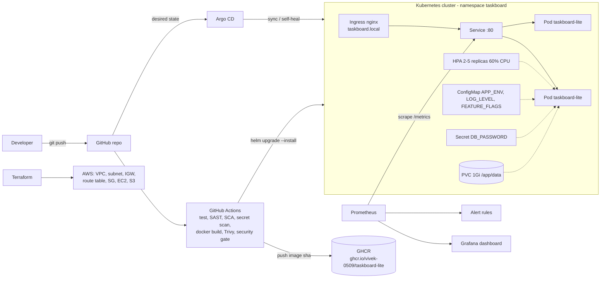

```text
                      +------------------------------ Kubernetes (minikube) ------------------------------+
  curl / browser      |  Ingress (nginx, host taskboard.local)                                            |
  --------------------+----> Service taskboard-lite:80 ---> Pods x2..5 (HPA)  <--- ConfigMap + Secret     |
                      |                                       |  /app/data  <--- PVC taskboard-lite-data |
                      |  Prometheus (scrapes /metrics) -> Grafana / alert rules                            |
                      +-------------------------------------------------------------------------------------+
  GitHub Actions: test -> sast -> sca -> secret-scan -> docker-build -> image-scan -> security-gate -> push (GHCR) -> deploy (helm)
  Argo CD: watches gitops/manifests in Git and reconciles the namespace
  Terraform: VPC 10.30.0.0/16, public subnet, IGW, route table, SG 80/22, EC2 t3.micro (docker host), S3 backups bucket
```

## 3. Technologies used

| Area | Technology |
|---|---|
| Application | Python 3.12, Flask 3.1, SQLite, prometheus-client, gunicorn |
| Tests | pytest + pytest-cov (17 tests, 92% coverage) |
| Containers | Docker multi-stage build (`python:3.12-alpine`, non-root uid 10001), docker compose |
| CI/CD | GitHub Actions (`.github/workflows/final-pipeline.yml`), `act` for local execution |
| DevSecOps | Bandit (SAST), pip-audit (SCA), gitleaks (secrets), Trivy (image), CodeQL on GitHub, security gate job |
| Registry | GitHub Container Registry (GHCR), image tagged with the commit SHA |
| Kubernetes | Deployment, Service, ConfigMap, Secret, Ingress (nginx), HPA, startup/readiness/liveness probes, PVC |
| Helm | chart `helm/taskboard-lite` (values.yaml, values-prod.yaml, templates, NOTES.txt) |
| Infrastructure | Terraform 1.14, AWS provider 6.x (VPC, subnet, IGW, route table, security group, EC2 + user_data, S3) |
| Monitoring | Prometheus 3.5, Grafana 11, alert rules, ServiceMonitor/PrometheusRule for kube-prometheus-stack |
| GitOps | Argo CD Application + kustomize manifests |

## 4. Repository layout

```text
final-devops-project/
├── application/        app.py, tests/, requirements*.txt, pytest.ini
├── docker/             Dockerfile (multi-stage), docker-compose.yml (app + Prometheus + Grafana)
├── kubernetes/         namespace, configmap, secret, pvc, deployment, service, ingress, hpa
├── helm/taskboard-lite/   Chart.yaml, values.yaml, values-prod.yaml, templates/
├── terraform/          versions.tf, variables.tf, main.tf, outputs.tf, terraform.tfvars.example, README.md
├── .github/workflows/  final-pipeline.yml (executed from the repo root copy)
├── security/           bandit.yaml, .gitleaks.toml, trivy.yaml, .trivyignore, README.md
├── monitoring/         prometheus.yml, alerts.yml, servicemonitor.yaml, prometheus-rules.yaml, grafana/ provisioning, README.md
├── gitops/             argocd-application.yaml, manifests/ (kustomize), README.md
├── troubleshooting/    4 intentionally broken manifests + README.md
├── screenshots/
└── README.md
```

## 5. Application setup (tests)

```bash
$ find . -type f -not -path "./screenshots/*" -not -path "./.venv/*" -not -path "*/.terraform/*" | sort | head -n 70
./.dockerignore
./.github/workflows/final-pipeline.yml
./.gitignore
./README.md
./application/.coverage
./application/.dockerignore
./application/.pytest_cache/.gitignore
./application/.pytest_cache/CACHEDIR.TAG
./application/.pytest_cache/README.md
./application/.pytest_cache/v/cache/nodeids
./application/.pytest_cache/v/cache/stepwise
./application/__pycache__/app.cpython-313.pyc
./application/app.py
./application/pytest.ini
./application/requirements-dev.txt
./application/requirements.txt
./application/tests/__pycache__/test_app.cpython-313-pytest-8.3.5.pyc
./application/tests/test_app.py
./docker/Dockerfile
./docker/data/tasks.db
./docker/docker-compose.yml
./gitops/README.md
./gitops/argocd-application.yaml
./gitops/manifests/configmap.yaml
./gitops/manifests/deployment.yaml
./gitops/manifests/hpa.yaml
./gitops/manifests/kustomization.yaml
./gitops/manifests/namespace.yaml
./gitops/manifests/pvc.yaml
./gitops/manifests/secret.yaml
./gitops/manifests/service.yaml
./helm/taskboard-lite/.helmignore
./helm/taskboard-lite/Chart.yaml
./helm/taskboard-lite/templates/NOTES.txt
./helm/taskboard-lite/templates/_helpers.tpl
./helm/taskboard-lite/templates/configmap.yaml
./helm/taskboard-lite/templates/deployment.yaml
./helm/taskboard-lite/templates/hpa.yaml
./helm/taskboard-lite/templates/ingress.yaml
./helm/taskboard-lite/templates/pvc.yaml
./helm/taskboard-lite/templates/secret.yaml
./helm/taskboard-lite/templates/service.yaml
./helm/taskboard-lite/values-prod.yaml
./helm/taskboard-lite/values.yaml
./kubernetes/configmap.yaml
./kubernetes/deployment.yaml
./kubernetes/hpa.yaml
./kubernetes/ingress.yaml
./kubernetes/namespace.yaml
./kubernetes/pvc.yaml
./kubernetes/secret.yaml
./kubernetes/service.yaml
./monitoring/README.md
./monitoring/alerts.yml
./monitoring/grafana/provisioning/dashboards/dashboard.yml
./monitoring/grafana/provisioning/dashboards/taskboard.json
./monitoring/grafana/provisioning/datasources/datasource.yml
./monitoring/prometheus-rules.yaml
./monitoring/prometheus.yml
./monitoring/servicemonitor.yaml
./security/.gitleaks.toml
./security/.trivyignore
./security/README.md
./security/bandit.yaml
./security/trivy.yaml
./terraform/.terraform.lock.hcl
./terraform/README.md
./terraform/main.tf
./terraform/outputs.tf
./terraform/terraform.tfstate
$ python3 -m venv .venv && source .venv/bin/activate && pip install -q -r application/requirements-dev.txt
$ cd application
$ pytest -v --cov=app --cov-report=term-missing
============================= test session starts ==============================
platform darwin -- Python 3.13.7, pytest-8.3.5, pluggy-1.6.0 -- /Users/vivek/Desktop/devops_final_assignment/session-21-final-devops-project/final-devops-project/.venv/bin/python3.13
cachedir: .pytest_cache
rootdir: /Users/vivek/Desktop/devops_final_assignment/session-21-final-devops-project/final-devops-project/application
configfile: pytest.ini
testpaths: tests
plugins: cov-6.0.0, platformdirs-4.12.3
collecting ... collected 17 items

tests/test_app.py::test_health_returns_ok PASSED                         [  5%]
tests/test_app.py::test_ready_returns_ready_when_database_works PASSED   [ 11%]
tests/test_app.py::test_ready_returns_503_when_database_is_unavailable PASSED [ 17%]
tests/test_app.py::test_metrics_exposes_request_counter PASSED           [ 23%]
tests/test_app.py::test_metrics_open_tasks_gauge_tracks_state PASSED     [ 29%]
tests/test_app.py::test_create_task PASSED                               [ 35%]
tests/test_app.py::test_create_task_requires_title PASSED                [ 41%]
tests/test_app.py::test_create_task_from_html_form_redirects_to_index PASSED [ 47%]
tests/test_app.py::test_list_tasks PASSED                                [ 52%]
tests/test_app.py::test_get_single_task PASSED                           [ 58%]
tests/test_app.py::test_get_missing_task_returns_404_json PASSED         [ 64%]
tests/test_app.py::test_update_task PASSED                               [ 70%]
tests/test_app.py::test_delete_task PASSED                               [ 76%]
tests/test_app.py::test_stats PASSED                                     [ 82%]
tests/test_app.py::test_config_reports_settings_but_hides_password PASSED [ 88%]
tests/test_app.py::test_config_reports_missing_password PASSED           [ 94%]
tests/test_app.py::test_index_page_lists_tasks PASSED                    [100%]

---------- coverage: platform darwin, python 3.13.7-final-0 ----------
Name     Stmts   Miss  Cover   Missing
--------------------------------------
app.py     217     17    92%   167, 225-227, 264, 272, 309-311, 319, 327, 363, 416, 442, 447, 470-471
--------------------------------------
TOTAL      217     17    92%


============================== 17 passed in 0.50s ==============================
```
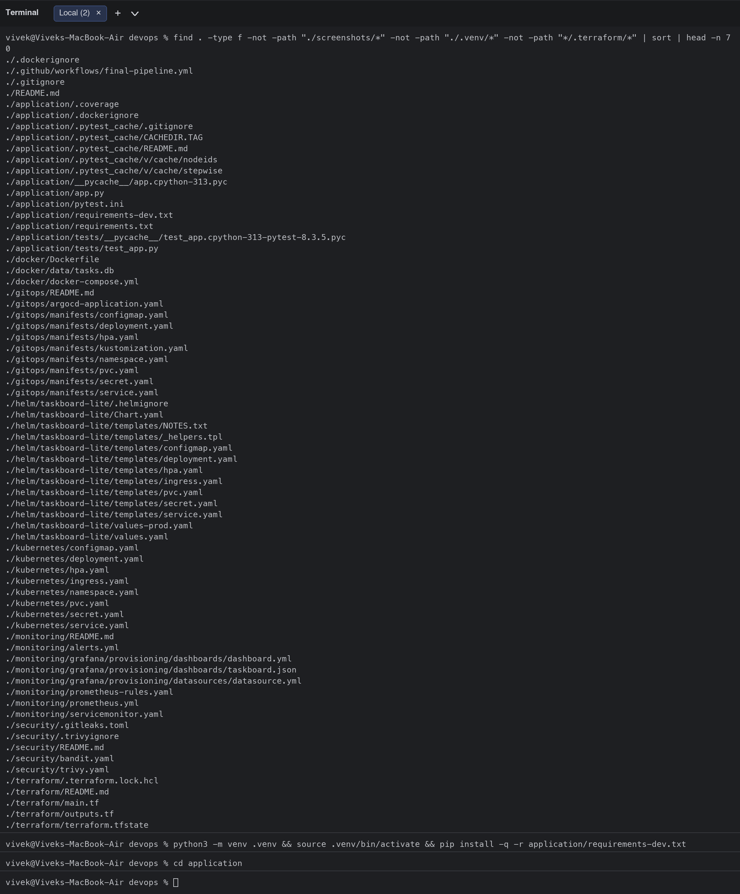
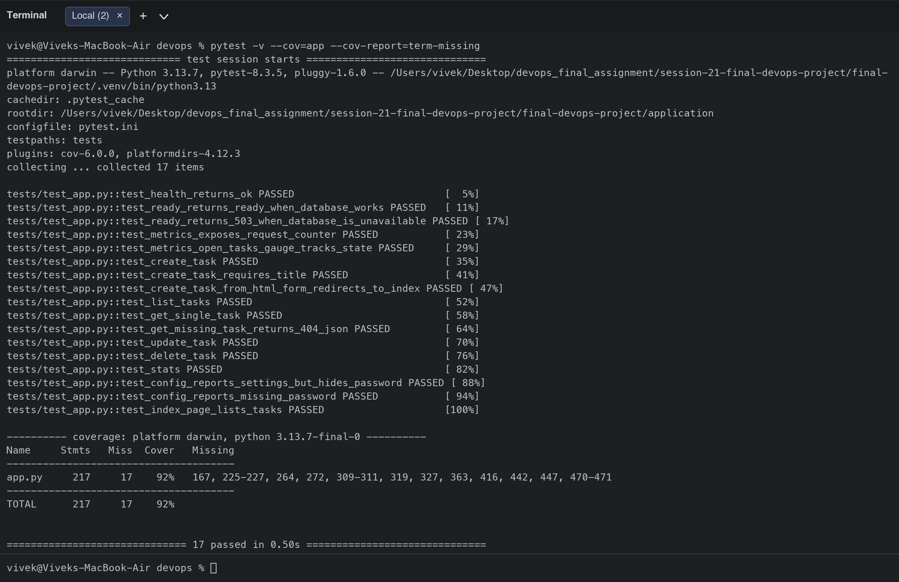

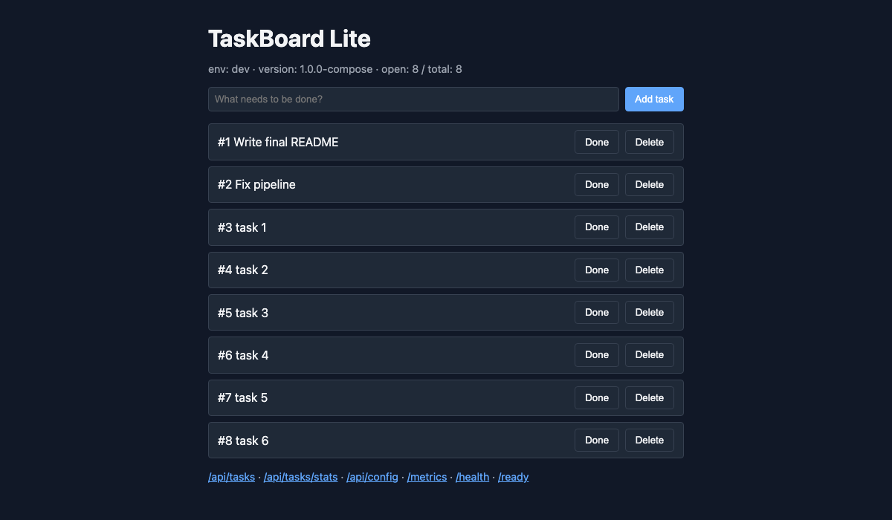

## 6. Docker setup

Multi-stage image, non-root user, Alpine base (the Debian `python:3.12-slim` base failed the Trivy gate with 44 HIGH CVEs, see the "before" output in [screenshots/](../screenshots/)); `docker compose` runs the app with Prometheus and Grafana.

```bash
$ grep -vE "^\s*#|^\s*$" docker/Dockerfile
FROM python:3.12-alpine AS builder
ENV PIP_NO_CACHE_DIR=1 \
    PIP_DISABLE_PIP_VERSION_CHECK=1
WORKDIR /build
COPY application/requirements.txt ./requirements.txt
RUN pip install --prefix=/install -r requirements.txt
FROM python:3.12-alpine
LABEL org.opencontainers.image.title="taskboard-lite" \
      org.opencontainers.image.description="TaskBoard Lite - final DevOps project workload" \
      org.opencontainers.image.source="https://github.com/vivek-0509/Devops_Final_Assignment_N_Project"
ENV PYTHONDONTWRITEBYTECODE=1 \
    PYTHONUNBUFFERED=1 \
    PORT=8000 \
    DATA_DIR=/app/data
COPY --from=builder /install /usr/local
RUN addgroup -g 10001 -S app \
 && adduser -u 10001 -S -G app -h /app -s /sbin/nologin app \
 && mkdir -p /app/data \
 && chown -R app:app /app
WORKDIR /app
COPY --chown=app:app application/ /app/
USER app
EXPOSE 8000
HEALTHCHECK --interval=30s --timeout=3s --start-period=10s --retries=3 \
  CMD python -c "import sys, urllib.request; sys.exit(0 if urllib.request.urlopen('http://127.0.0.1:8000/health', timeout=2).status == 200 else 1)"
CMD ["gunicorn", "-b", "0.0.0.0:8000", "-w", "1", "--threads", "4", "app:app"]
$ docker build -f docker/Dockerfile -t taskboard-lite:local .
#0 building with "colima" instance using docker driver

#1 [internal] load build definition from Dockerfile
#1 transferring dockerfile: 2.34kB done
#1 DONE 0.0s

#2 DONE 0.7s

#3 docker-image://docker.io/docker/dockerfile:1@sha256:4edf897a3ffa55b89f906fc8cc78afdb3f1834cc9c7083565e611a8a7d5fe99e
#3 CACHED

#4 [internal] load metadata for docker.io/library/python:3.12-alpine
#4 DONE 0.9s

#5 [internal] load .dockerignore
#5 transferring context: 387B done
#5 DONE 0.0s

#6 [internal] load build context
#6 transferring context: 256B done
#6 DONE 0.0s

#7 [builder 1/4] FROM docker.io/library/python:3.12-alpine@sha256:1b668429b3511ab407d8e00648891631b0b1a4d7e15e3ca70f38ab5b91ad4ab4
#7 DONE 0.0s

#8 [builder 2/4] WORKDIR /build
#8 DONE 0.0s

#9 [builder 3/4] COPY application/requirements.txt ./requirements.txt
#9 DONE 0.0s

#10 [builder 4/4] RUN pip install --prefix=/install -r requirements.txt
#10 2.868 Collecting flask==3.1.3 (from -r requirements.txt (line 1))
#10 3.069   Downloading flask-3.1.3-py3-none-any.whl.metadata (3.2 kB)
#10 3.126 Collecting prometheus-client==0.21.1 (from -r requirements.txt (line 2))
#10 3.213   Downloading prometheus_client-0.21.1-py3-none-any.whl.metadata (1.8 kB)
#10 3.258 Collecting gunicorn==23.0.0 (from -r requirements.txt (line 3))
#10 3.297   Downloading gunicorn-23.0.0-py3-none-any.whl.metadata (4.4 kB)
#10 3.338 Collecting blinker>=1.9.0 (from flask==3.1.3->-r requirements.txt (line 1))
#10 3.435   Downloading blinker-1.9.0-py3-none-any.whl.metadata (1.6 kB)
#10 3.478 Collecting click>=8.1.3 (from flask==3.1.3->-r requirements.txt (line 1))
#10 3.516   Downloading click-8.5.0-py3-none-any.whl.metadata (2.6 kB)
#10 3.550 Collecting itsdangerous>=2.2.0 (from flask==3.1.3->-r requirements.txt (line 1))
#10 3.590   Downloading itsdangerous-2.2.0-py3-none-any.whl.metadata (1.9 kB)
#10 3.630 Collecting jinja2>=3.1.2 (from flask==3.1.3->-r requirements.txt (line 1))
#10 3.673   Downloading jinja2-3.1.6-py3-none-any.whl.metadata (2.9 kB)
#10 3.777 Collecting markupsafe>=2.1.1 (from flask==3.1.3->-r requirements.txt (line 1))
#10 3.816   Downloading markupsafe-3.0.4-cp312-cp312-musllinux_1_2_aarch64.whl.metadata (2.7 kB)
#10 3.857 Collecting werkzeug>=3.1.0 (from flask==3.1.3->-r requirements.txt (line 1))
#10 3.895   Downloading werkzeug-3.1.9-py3-none-any.whl.metadata (4.1 kB)
#10 3.934 Collecting packaging (from gunicorn==23.0.0->-r requirements.txt (line 3))
#10 3.972   Downloading packaging-26.3-py3-none-any.whl.metadata (3.5 kB)
#10 4.017 Downloading flask-3.1.3-py3-none-any.whl (103 kB)
#10 4.173 Downloading prometheus_client-0.21.1-py3-none-any.whl (54 kB)
#10 4.227 Downloading gunicorn-23.0.0-py3-none-any.whl (85 kB)
#10 4.278 Downloading blinker-1.9.0-py3-none-any.whl (8.5 kB)
#10 4.318 Downloading click-8.5.0-py3-none-any.whl (125 kB)
#10 4.393 Downloading itsdangerous-2.2.0-py3-none-any.whl (16 kB)
#10 4.432 Downloading jinja2-3.1.6-py3-none-any.whl (134 kB)
#10 4.486 Downloading markupsafe-3.0.4-cp312-cp312-musllinux_1_2_aarch64.whl (23 kB)
#10 4.525 Downloading werkzeug-3.1.9-py3-none-any.whl (228 kB)
#10 4.630 Downloading packaging-26.3-py3-none-any.whl (129 kB)
#10 4.677 Installing collected packages: prometheus-client, packaging, markupsafe, itsdangerous, click, blinker, werkzeug, jinja2, gunicorn, flask
#10 5.307 Successfully installed blinker-1.9.0 click-8.5.0 flask-3.1.3 gunicorn-23.0.0 itsdangerous-2.2.0 jinja2-3.1.6 markupsafe-3.0.4 packaging-26.3 prometheus-client-0.21.1 werkzeug-3.1.9
#10 5.307 WARNING: Running pip as the 'root' user can result in broken permissions and conflicting behaviour with the system package manager, possibly rendering your system unusable. It is recommended to use a virtual environment instead: https://pip.pypa.io/warnings/venv. Use the --root-user-action option if you know what you are doing and want to suppress this warning.
#10 DONE 5.4s

#11 [stage-1 2/5] COPY --from=builder /install /usr/local
#11 DONE 0.1s

#12 [stage-1 3/5] RUN addgroup -g 10001 -S app  && adduser -u 10001 -S -G app -h /app -s /sbin/nologin app  && mkdir -p /app/data  && chown -R app:app /app
#12 DONE 0.2s

#13 [stage-1 4/5] WORKDIR /app
#13 DONE 0.0s

#14 [stage-1 5/5] COPY --chown=app:app application/ /app/
#14 DONE 0.0s

#15 exporting to image
#15 exporting layers
#15 exporting layers 0.3s done
#15 exporting manifest sha256:cee122d5cba0ce0bc72cd28a3bad39a0c0732742ae0e078f0bf59f2ca5fa7b46 0.1s done
#15 exporting config sha256:5c255dabd4e731c36dbb9ba8177d9600fd9f6cd3d390844c97689e9b9d0585af done
#15 exporting attestation manifest sha256:527ed1b5bb3c2635704d06632180a62776a042291c398f41b3a9158cd71fa4e1 done
#15 exporting manifest list sha256:0695061ec7be14b71fb5d14a6bd947a54f941fa823cd5346f53a6fc987556b8a done
#15 naming to docker.io/library/taskboard-lite:local done
#15 unpacking to docker.io/library/taskboard-lite:local 0.1s done
#15 DONE 0.5s
$ docker images taskboard-lite
IMAGE                  ID             DISK USAGE   CONTENT SIZE   EXTRA
taskboard-lite:local   0695061ec7be       98.5MB         23.7MB        
$ trivy image --config security/trivy.yaml --scanners vuln --format table taskboard-lite:local; echo "trivy exit code: $?"
2026-10-07T14:57:35+05:30	INFO	Loaded	file_path="security/trivy.yaml"
2026-10-07T14:57:35+05:30	WARN	'vulnerability.type' in config file is deprecated. Use 'pkg.types' instead.
2026-10-07T14:57:35+05:30	INFO	[vuln] Vulnerability scanning is enabled
2026-10-07T14:57:36+05:30	INFO	[python] Licenses acquired from one or more METADATA files may be subject to additional terms. Use `--debug` flag to see all affected packages.
2026-10-07T14:57:36+05:30	INFO	Detected OS	family="alpine" version="3.24.2"
2026-10-07T14:57:36+05:30	INFO	[alpine] Detecting vulnerabilities...	os_version="3.24" repository="3.24" pkg_num=38
2026-10-07T14:57:36+05:30	INFO	Number of language-specific files	num=1
2026-10-07T14:57:36+05:30	INFO	[python-pkg] Detecting vulnerabilities...
2026-10-07T14:57:36+05:30	WARN	Using severities from other vendors for some vulnerabilities. Read https://trivy.dev/docs/v0.75/guide/scanner/vulnerability#severity-selection for details.

Report Summary

┌──────────────────────────────────────────────────────────────────────────────────┬────────────┬─────────────────┐
│                                      Target                                      │    Type    │ Vulnerabilities │
├──────────────────────────────────────────────────────────────────────────────────┼────────────┼─────────────────┤
│ taskboard-lite:local (alpine 3.24.2)                                             │   alpine   │        0        │
├──────────────────────────────────────────────────────────────────────────────────┼────────────┼─────────────────┤
│ usr/local/lib/python3.12/site-packages/blinker-1.9.0.dist-info/METADATA          │ python-pkg │        0        │
├──────────────────────────────────────────────────────────────────────────────────┼────────────┼─────────────────┤
│ usr/local/lib/python3.12/site-packages/click-8.5.0.dist-info/METADATA            │ python-pkg │        0        │
├──────────────────────────────────────────────────────────────────────────────────┼────────────┼─────────────────┤
│ usr/local/lib/python3.12/site-packages/flask-3.1.3.dist-info/METADATA            │ python-pkg │        0        │
├──────────────────────────────────────────────────────────────────────────────────┼────────────┼─────────────────┤
│ usr/local/lib/python3.12/site-packages/gunicorn-23.0.0.dist-info/METADATA        │ python-pkg │        0        │
├──────────────────────────────────────────────────────────────────────────────────┼────────────┼─────────────────┤
│ usr/local/lib/python3.12/site-packages/itsdangerous-2.2.0.dist-info/METADATA     │ python-pkg │        0        │
├──────────────────────────────────────────────────────────────────────────────────┼────────────┼─────────────────┤
│ usr/local/lib/python3.12/site-packages/jinja2-3.1.6.dist-info/METADATA           │ python-pkg │        0        │
├──────────────────────────────────────────────────────────────────────────────────┼────────────┼─────────────────┤
│ usr/local/lib/python3.12/site-packages/markupsafe-3.0.4.dist-info/METADATA       │ python-pkg │        0        │
├──────────────────────────────────────────────────────────────────────────────────┼────────────┼─────────────────┤
│ usr/local/lib/python3.12/site-packages/packaging-26.3.dist-info/METADATA         │ python-pkg │        0        │
├──────────────────────────────────────────────────────────────────────────────────┼────────────┼─────────────────┤
│ usr/local/lib/python3.12/site-packages/pip-25.0.1.dist-info/METADATA             │ python-pkg │        0        │
├──────────────────────────────────────────────────────────────────────────────────┼────────────┼─────────────────┤
│ usr/local/lib/python3.12/site-packages/prometheus_client-0.21.1.dist-info/METAD- │ python-pkg │        0        │
│ ATA                                                                              │            │                 │
├──────────────────────────────────────────────────────────────────────────────────┼────────────┼─────────────────┤
│ usr/local/lib/python3.12/site-packages/werkzeug-3.1.9.dist-info/METADATA         │ python-pkg │        0        │
└──────────────────────────────────────────────────────────────────────────────────┴────────────┴─────────────────┘
Legend:
- '-': Not scanned
- '0': Clean (no security findings detected)

trivy exit code: 0
$ docker run --rm taskboard-lite:local id
uid=10001(app) gid=10001(app) groups=10001(app),10001(app)
```
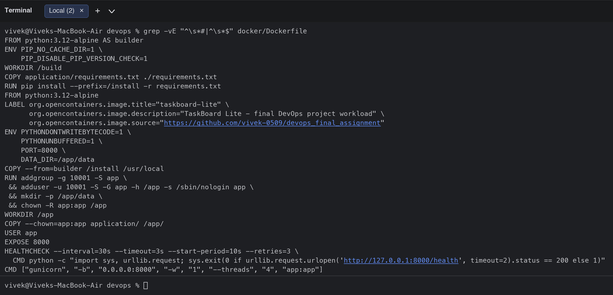
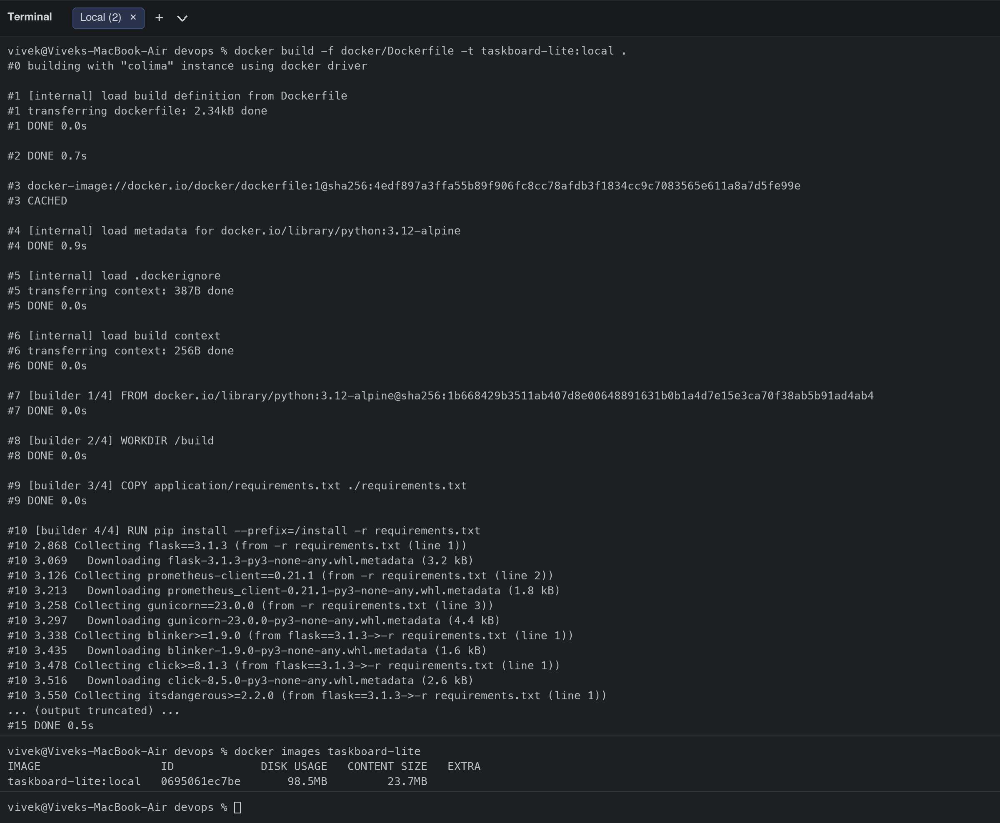
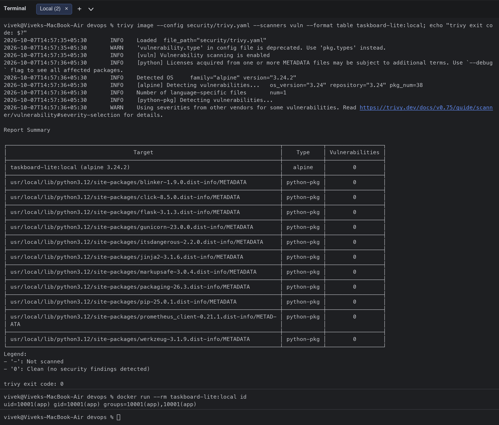

```bash
$ cd docker
$ docker compose up -d
 Network docker_default Creating 
 Network docker_default Creating 
 Network docker_default Created 
 Network docker_default Created 
 Container taskboard-app Creating 
 Container taskboard-app Created 
 Container taskboard-prometheus Creating 
 Container taskboard-prometheus Created 
 Container taskboard-grafana Creating 
 Container taskboard-grafana Created 
 Container taskboard-app Starting 
 Container taskboard-app Started 
 Container taskboard-prometheus Starting 
Error response from daemon: failed to set up container networking: driver failed programming external connectivity on endpoint taskboard-prometheus (550cfa1c518de99588f7e8fa7e11c689ba8c68e258cf5f99fab3ce3f7793989c): Bind for 0.0.0.0:9090 failed: port is already allocated
$ docker compose ps
NAME            IMAGE                  COMMAND                  SERVICE   CREATED          STATUS                    PORTS
taskboard-app   taskboard-lite:local   "gunicorn -b 0.0.0.0…"   app       15 seconds ago   Up 15 seconds (healthy)   0.0.0.0:8000->8000/tcp, [::]:8000->8000/tcp
$ curl -s http://localhost:8000/health
{"status":"ok"}
$ curl -s http://localhost:8000/ready
{"status":"ready"}
$ curl -s -X POST -H "Content-Type: application/json" -d "{\"title\":\"Write final README\",\"priority\":\"high\"}" http://localhost:8000/api/tasks
{"created_at":"2026-10-07T09:23:56+00:00","done":false,"id":1,"title":"Write final README","updated_at":"2026-10-07T09:23:56+00:00"}
$ curl -s -X POST -H "Content-Type: application/json" -d "{\"title\":\"Fix pipeline\",\"priority\":\"medium\"}" http://localhost:8000/api/tasks
{"created_at":"2026-10-07T09:23:56+00:00","done":false,"id":2,"title":"Fix pipeline","updated_at":"2026-10-07T09:23:56+00:00"}
$ curl -s http://localhost:8000/api/tasks | jq -c ".[] | {id, title, status}" 2>/dev/null || curl -s http://localhost:8000/api/tasks
{"id":1,"title":"Write final README","status":null}
{"id":2,"title":"Fix pipeline","status":null}
$ curl -s http://localhost:8000/api/tasks/stats
{"done":0,"open":2,"total":2}
$ curl -s http://localhost:8000/api/config
{"app_env":"dev","data_dir":"/app/data","db_password_set":true,"feature_flags":["dark-mode","metrics"],"log_level":"DEBUG","version":"1.0.0-compose"}
$ curl -s http://localhost:8000/metrics | grep -E "^taskboard_"
taskboard_tasks_created_total 0.0
taskboard_tasks_created_created 1.7913650218579779e+09
taskboard_tasks_open 2.0
$ curl -s "http://localhost:9090/api/v1/targets" | jq -r ".data.activeTargets[] | \"\(.labels.job)\t\(.health)\""
cadvisor	up
node-exporter	up
prometheus	up
sample-app	up
$ docker compose down -v
 Container taskboard-grafana Stopping 
 Container taskboard-grafana Stopped 
 Container taskboard-grafana Removing 
 Container taskboard-grafana Removed 
 Container taskboard-prometheus Stopping 
 Container taskboard-prometheus Stopped 
 Container taskboard-prometheus Removing 
 Container taskboard-prometheus Removed 
 Container taskboard-app Stopping 
 Container taskboard-app Stopped 
 Container taskboard-app Removing 
 Container taskboard-app Removed 
 Network docker_default Removing 
 Network docker_default Removed
```
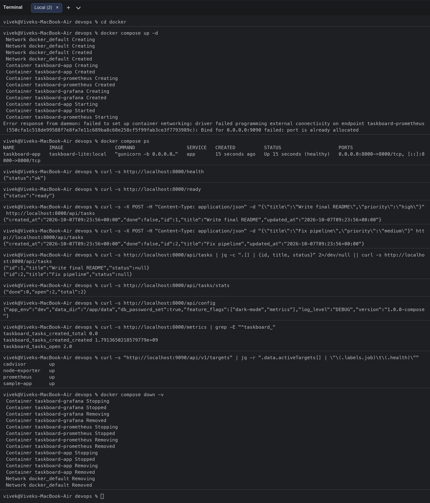

## 7. Kubernetes deployment (via Helm)

Objects: Namespace `taskboard`, ConfigMap (APP_ENV, LOG_LEVEL, FEATURE_FLAGS), Secret (DB_PASSWORD), PVC 1Gi (`/app/data`, SQLite file survives Pod restarts), Deployment (2 replicas, startup/readiness/liveness probes, resources, non-root securityContext), Service, Ingress (`taskboard.local`), HPA (2-5 replicas at 60% CPU).

```bash
$ minikube image load taskboard-lite:local
$ helm lint helm/taskboard-lite
==> Linting helm/taskboard-lite
[INFO] Chart.yaml: icon is recommended

1 chart(s) linted, 0 chart(s) failed
$ helm template taskboard-lite helm/taskboard-lite | grep -E "^kind:|^  name:" | paste - - | sort | uniq
kind: ConfigMap	  name: taskboard-lite-config
kind: Deployment	  name: taskboard-lite
kind: HorizontalPodAutoscaler	  name: taskboard-lite
kind: Ingress	  name: taskboard-lite
kind: PersistentVolumeClaim	  name: taskboard-lite-data
kind: Secret	  name: taskboard-lite-secret
kind: Service	  name: taskboard-lite
$ helm upgrade --install taskboard-lite helm/taskboard-lite -n taskboard --create-namespace --wait --timeout 180s
Release "taskboard-lite" does not exist. Installing it now.
NAME: taskboard-lite
LAST DEPLOYED: Wed Oct  7 14:57:42 2026
NAMESPACE: taskboard
STATUS: deployed
REVISION: 1
DESCRIPTION: Install complete
TEST SUITE: None
NOTES:
taskboard-lite 0.1.0 (app 1.0.0) installed as release "taskboard-lite" in namespace "taskboard".

Image ........ taskboard-lite:local
Replicas ..... 2-5 (HPA, CPU 60%)
Persistence .. PVC taskboard-lite-data (1Gi)
Strategy ..... Recreate

Wait for the rollout:
  kubectl -n taskboard rollout status deployment/taskboard-lite

Reach the app through the ingress (needs an NGINX ingress controller and a hosts entry):
  echo "$(minikube ip) taskboard.local" | sudo tee -a /etc/hosts
  curl http://taskboard.local/health

Or with a port-forward:
  kubectl -n taskboard port-forward svc/taskboard-lite 8080:80
  curl http://localhost:8080/health
  curl http://localhost:8080/ready
  curl http://localhost:8080/api/config
  curl -X POST -H 'Content-Type: application/json' -d '{"title":"hello"}' http://localhost:8080/api/tasks

Metrics are exposed on /metrics for Prometheus (see monitoring/servicemonitor.yaml).
$ helm list -n taskboard
NAME          	NAMESPACE	REVISION	UPDATED                             	STATUS  	CHART               	APP VERSION
taskboard-lite	taskboard	1       	2026-10-07 14:57:42.604909 +0530 IST	deployed	taskboard-lite-0.1.0	1.0.0      
$ kubectl get all,ingress,pvc,hpa,configmap,secret -n taskboard
NAME                                  READY   STATUS    RESTARTS   AGE
pod/taskboard-lite-64667854f7-dztlb   1/1     Running   0          5s
pod/taskboard-lite-64667854f7-p2jgr   1/1     Running   0          5s

NAME                     TYPE        CLUSTER-IP    EXTERNAL-IP   PORT(S)   AGE
service/taskboard-lite   ClusterIP   10.99.87.47   <none>        80/TCP    5s

NAME                             READY   UP-TO-DATE   AVAILABLE   AGE
deployment.apps/taskboard-lite   2/2     2            2           5s

NAME                                        DESIRED   CURRENT   READY   AGE
replicaset.apps/taskboard-lite-64667854f7   2         2         2       5s

NAME                                                 REFERENCE                   TARGETS              MINPODS   MAXPODS   REPLICAS   AGE
horizontalpodautoscaler.autoscaling/taskboard-lite   Deployment/taskboard-lite   cpu: <unknown>/60%   2         5         1          5s

NAME                                       CLASS   HOSTS             ADDRESS   PORTS   AGE
ingress.networking.k8s.io/taskboard-lite   nginx   taskboard.local             80      5s

NAME                                        STATUS   VOLUME                                     CAPACITY   ACCESS MODES   STORAGECLASS   VOLUMEATTRIBUTESCLASS   AGE
persistentvolumeclaim/taskboard-lite-data   Bound    pvc-f7d68485-766d-4068-9f95-e1185a5f1667   1Gi        RWO            standard       <unset>                 5s

NAME                              DATA   AGE
configmap/kube-root-ca.crt        1      5s
configmap/taskboard-lite-config   4      5s

NAME                                          TYPE                 DATA   AGE
secret/sh.helm.release.v1.taskboard-lite.v1   helm.sh/release.v1   1      5s
secret/taskboard-lite-secret                  Opaque               1      5s
$ kubectl rollout status deployment/taskboard-lite -n taskboard
deployment "taskboard-lite" successfully rolled out
```
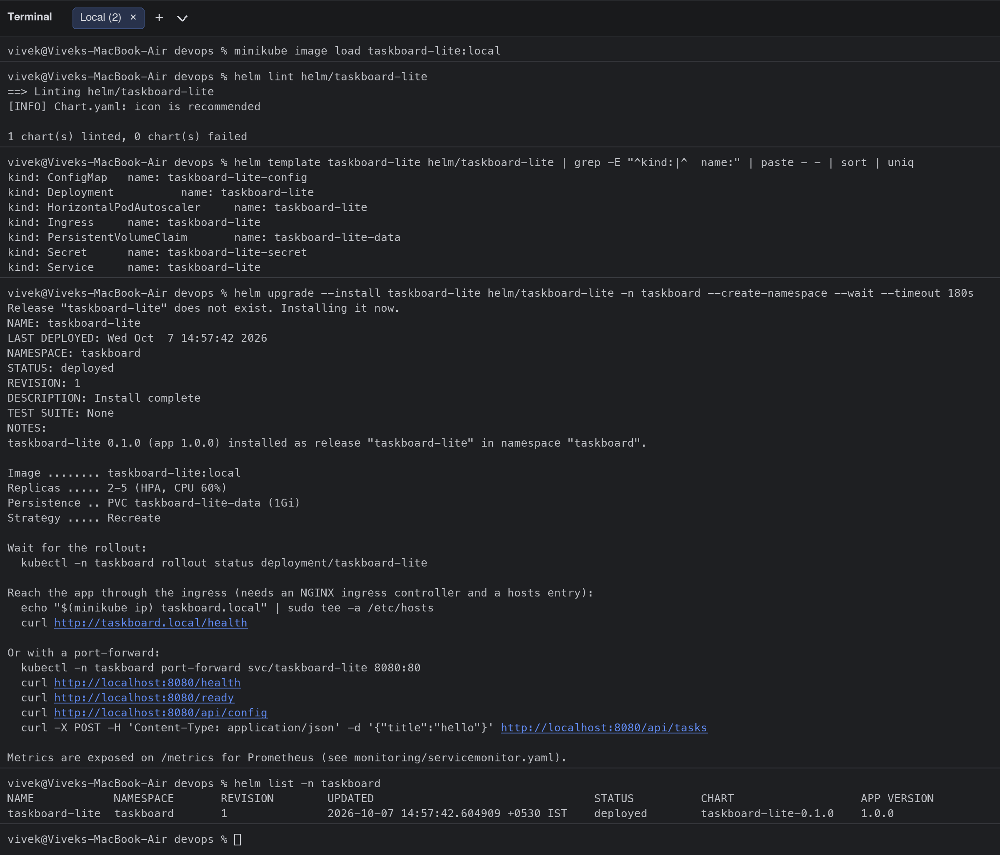
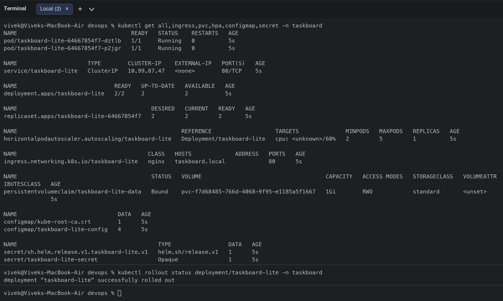

### Verification through the Ingress, ConfigMap/Secret injection, PVC persistence, HPA and probes

```bash
$ kubectl get pods -n taskboard -o wide
NAME                              READY   STATUS    RESTARTS   AGE   IP            NODE       NOMINATED NODE   READINESS GATES
taskboard-lite-64667854f7-dztlb   1/1     Running   0          5s    10.244.0.25   minikube   <none>           <none>
taskboard-lite-64667854f7-p2jgr   1/1     Running   0          5s    10.244.0.24   minikube   <none>           <none>
$ kubectl describe pod -n taskboard -l app.kubernetes.io/name=taskboard-lite | grep -E "Liveness|Readiness|Startup" | sort -u
    Liveness:   http-get http://:http/health delay=0s timeout=2s period=10s successThreshold=1 failureThreshold=3
    Readiness:  http-get http://:http/ready delay=0s timeout=2s period=5s successThreshold=1 failureThreshold=3
    Startup:    http-get http://:http/health delay=0s timeout=1s period=2s successThreshold=1 failureThreshold=30
$ kubectl get ingress -n taskboard
NAME             CLASS   HOSTS             ADDRESS   PORTS   AGE
taskboard-lite   nginx   taskboard.local             80      6s
$ colima ssh -- curl -s --resolve taskboard.local:80:192.168.49.2 http://taskboard.local/health
{"status":"ok"}
$ colima ssh -- curl -s --resolve taskboard.local:80:192.168.49.2 http://taskboard.local/ready
{"status":"ready"}
$ colima ssh -- curl -s --resolve taskboard.local:80:192.168.49.2 http://taskboard.local/api/config
{"app_env":"production","data_dir":"/app/data","db_password_set":true,"feature_flags":["dark-mode","metrics"],"log_level":"INFO","version":"1.0.0"}
$ colima ssh -- curl -s -X POST -H 'Content-Type: application/json' -d '{"title":"Deploy with Helm","priority":"high"}' --resolve taskboard.local:80:192.168.49.2 http://taskboard.local/api/tasks
{"created_at":"2026-10-07T09:27:59+00:00","done":false,"id":1,"title":"Deploy with Helm","updated_at":"2026-10-07T09:27:59+00:00"}
$ colima ssh -- curl -s --resolve taskboard.local:80:192.168.49.2 http://taskboard.local/api/tasks/stats
{"done":0,"open":1,"total":1}
$ colima ssh -- curl -s --resolve taskboard.local:80:192.168.49.2 http://taskboard.local/metrics | grep -E '^taskboard_'
taskboard_requests_total{endpoint="/health",method="GET",status="200"} 3.0
taskboard_requests_total{endpoint="/ready",method="GET",status="200"} 3.0
taskboard_requests_total{endpoint="/api/config",method="GET",status="200"} 1.0
taskboard_requests_total{endpoint="/api/tasks",method="POST",status="201"} 1.0
taskboard_requests_total{endpoint="/api/tasks/stats",method="GET",status="200"} 1.0
taskboard_requests_created{endpoint="/health",method="GET",status="200"} 1.7913652673810759e+09
taskboard_requests_created{endpoint="/ready",method="GET",status="200"} 1.7913652673917506e+09
taskboard_requests_created{endpoint="/api/config",method="GET",status="200"} 1.7913652792851248e+09
taskboard_requests_created{endpoint="/api/tasks",method="POST",status="201"} 1.7913652796376665e+09
taskboard_requests_created{endpoint="/api/tasks/stats",method="GET",status="200"} 1.7913652799561722e+09
taskboard_tasks_created_total 1.0
taskboard_tasks_created_created 1.7913652672818465e+09
taskboard_tasks_open 1.0
$ kubectl exec -n taskboard deploy/taskboard-lite -- env | grep -E "APP_ENV|LOG_LEVEL|FEATURE_FLAGS|DB_PASSWORD" | sed "s/DB_PASSWORD=.*/DB_PASSWORD=******** (injected from Secret)/"
LOG_LEVEL=INFO
APP_ENV=production
FEATURE_FLAGS=dark-mode,metrics
DB_PASSWORD=******** (injected from Secret)
$ kubectl get pvc -n taskboard
NAME                  STATUS   VOLUME                                     CAPACITY   ACCESS MODES   STORAGECLASS   VOLUMEATTRIBUTESCLASS   AGE
taskboard-lite-data   Bound    pvc-f7d68485-766d-4068-9f95-e1185a5f1667   1Gi        RWO            standard       <unset>                 18s
$ kubectl delete pod -n taskboard taskboard-lite-64667854f7-dztlb
pod "taskboard-lite-64667854f7-dztlb" deleted from taskboard namespace
$ kubectl rollout status deployment/taskboard-lite -n taskboard
Waiting for deployment "taskboard-lite" rollout to finish: 1 of 2 updated replicas are available...
deployment "taskboard-lite" successfully rolled out
$ colima ssh -- curl -s --resolve taskboard.local:80:192.168.49.2 http://taskboard.local/api/tasks/stats   # data survived the Pod restart (PVC)
{"done":0,"open":1,"total":1}
$ kubectl get hpa -n taskboard
NAME             REFERENCE                   TARGETS              MINPODS   MAXPODS   REPLICAS   AGE
taskboard-lite   Deployment/taskboard-lite   cpu: <unknown>/60%   2         5         2          23s
$ kubectl logs -n taskboard deploy/taskboard-lite --tail=5
Found 2 pods, using pod/taskboard-lite-64667854f7-p2jgr
[2026-10-07 09:27:46 +0000] [1] [INFO] Starting gunicorn 23.0.0
[2026-10-07 09:27:46 +0000] [1] [INFO] Listening at: http://0.0.0.0:8000 (1)
[2026-10-07 09:27:46 +0000] [1] [INFO] Using worker: gthread
[2026-10-07 09:27:46 +0000] [7] [INFO] Booting worker with pid: 7
2026-10-07 09:27:47,279 INFO taskboard-lite: starting taskboard-lite env=production log_level=INFO data_dir=/app/data version=1.0.0 db_password_set=True flags=dark-mode,metrics
```
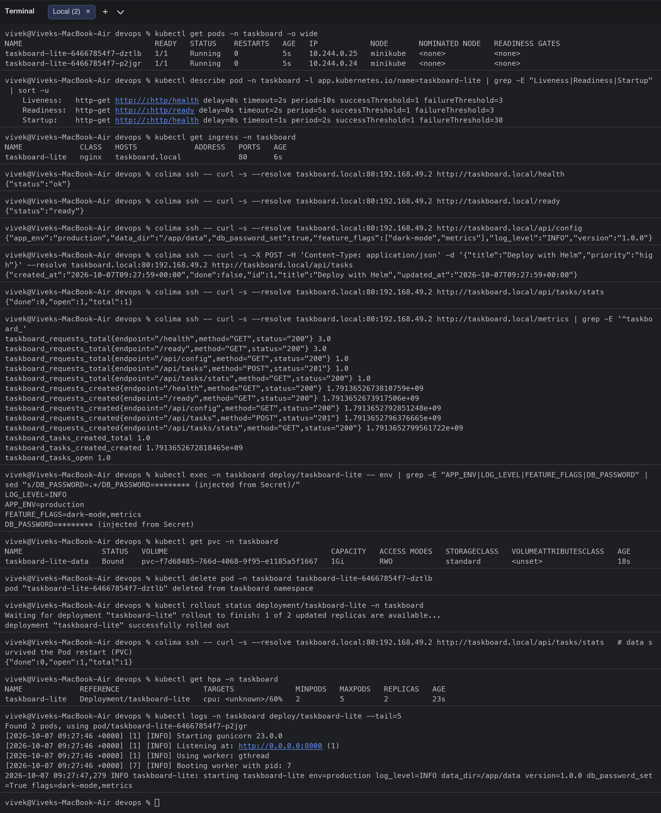

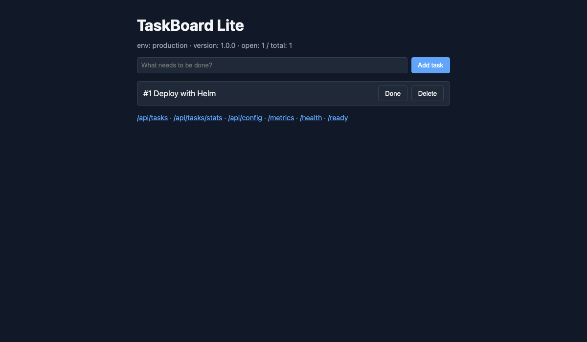

## 8. Helm deployment

The chart lives in [helm/taskboard-lite](../helm/taskboard-lite): `helm lint`, `helm template` and `helm upgrade --install taskboard-lite helm/taskboard-lite -n taskboard --create-namespace` are shown above. `values-prod.yaml` switches to 3 replicas and `LOG_LEVEL=WARNING`; the CI deploy job installs the chart with `--set image.tag=<sha>`.

## 9. Terraform infrastructure

[terraform/](../terraform/) provisions a VPC (10.30.0.0/16), public subnet, Internet Gateway, route table, security group (80/22), an EC2 `t3.micro` whose user_data installs Docker and runs the application image, and a private S3 bucket for backups (12 resources). Executed for real and destroyed afterwards:

```bash
$ cat terraform.tfvars
# Copy to terraform.tfvars and adjust. terraform.tfvars is git-ignored.
aws_region = "us-east-1"
project_name       = "taskboard-lite"
vpc_cidr           = "10.30.0.0/16"
public_subnet_cidr = "10.30.1.0/24"
instance_type      = "t3.micro"

# Must be globally unique, lowercase, 3-63 characters.
bucket_name = "vivek-taskboard-backups-20261007-cb9919"

# Restrict SSH to your own public IP (curl ifconfig.me).
allowed_ssh_cidr = "0.0.0.0/0"
# Existing EC2 key pair name, or "" for no SSH key.
key_name = ""

# Image published by .github/workflows/final-pipeline.yml (linux/amd64).
app_image = "ghcr.io/vivek-0509/taskboard-lite:latest"
app_env   = "production"
$ terraform init -no-color | tail -n 4
so that Terraform can guarantee to make the same selections by default when
you run "terraform init" in the future.

Terraform has been successfully initialized!
$ terraform fmt -recursive
terraform.tfvars
$ terraform validate -no-color
Success! The configuration is valid.

$ terraform plan -no-color -out=tfplan | tail -n 25
      + tags                                 = {
          + "Name" = "taskboard-lite-vpc"
        }
      + tags_all                             = {
          + "ManagedBy" = "Terraform"
          + "Name"      = "taskboard-lite-vpc"
          + "Owner"     = "Vivek Solanki"
          + "Project"   = "taskboard-lite"
          + "Session"   = "21-final-project"
        }
    }

Plan: 12 to add, 0 to change, 0 to destroy.

Changes to Outputs:
  + ami_id             = (sensitive value)
  + app_url            = (known after apply)
  + backup_bucket_name = "vivek-taskboard-backups-20261007-cb9919"
  + ec2_instance_id    = (known after apply)
  + ec2_public_ip      = (known after apply)
  + health_url         = (known after apply)
  + public_subnet_id   = (known after apply)
  + security_group_id  = (known after apply)
  + ssh_command        = (known after apply)
  + vpc_id             = (known after apply)
$ terraform apply -no-color -auto-approve tfplan | tail -n 25
aws_security_group.web: Creation complete after 5s [id=sg-018edbf6471c47b55]
aws_subnet.public: Still creating... [00m10s elapsed]
aws_subnet.public: Creation complete after 12s [id=subnet-0997f61e90f954a20]
aws_route_table_association.public: Creating...
aws_route_table_association.public: Creation complete after 1s [id=rtbassoc-0e00f1cc29f1bdd27]
aws_instance.app: Creating...
aws_instance.app: Still creating... [00m10s elapsed]
aws_instance.app: Creation complete after 16s [id=i-0a847e0ec152a5e01]
aws_s3_object.instance_info: Creating...
aws_s3_object.instance_info: Creation complete after 1s [id=vivek-taskboard-backups-20261007-cb9919/instance-info.txt]

Apply complete! Resources: 12 added, 0 changed, 0 destroyed.

Outputs:

ami_id = <sensitive>
app_url = "http://100.54.40.162"
backup_bucket_name = "vivek-taskboard-backups-20261007-cb9919"
ec2_instance_id = "i-0a847e0ec152a5e01"
ec2_public_ip = "100.54.40.162"
health_url = "http://100.54.40.162/health"
public_subnet_id = "subnet-0997f61e90f954a20"
security_group_id = "sg-018edbf6471c47b55"
ssh_command = "ssh -i ~/.ssh/<key>.pem ec2-user@100.54.40.162"
vpc_id = "vpc-092bcb1a279dfdf99"
$ terraform output -no-color
ami_id = <sensitive>
app_url = "http://100.54.40.162"
backup_bucket_name = "vivek-taskboard-backups-20261007-cb9919"
ec2_instance_id = "i-0a847e0ec152a5e01"
ec2_public_ip = "100.54.40.162"
health_url = "http://100.54.40.162/health"
public_subnet_id = "subnet-0997f61e90f954a20"
security_group_id = "sg-018edbf6471c47b55"
ssh_command = "ssh -i ~/.ssh/<key>.pem ec2-user@100.54.40.162"
vpc_id = "vpc-092bcb1a279dfdf99"
$ terraform state list
data.aws_ssm_parameter.al2023_ami
aws_instance.app
aws_internet_gateway.main
aws_route_table.public
aws_route_table_association.public
aws_s3_bucket.backups
aws_s3_bucket_public_access_block.backups
aws_s3_bucket_server_side_encryption_configuration.backups
aws_s3_bucket_versioning.backups
aws_s3_object.instance_info
aws_security_group.web
aws_subnet.public
aws_vpc.main
$ aws ec2 describe-instances --filters Name=tag:Project,Values=taskboard-lite Name=instance-state-name,Values=running --query 'Reservations[].Instances[].[InstanceId,InstanceType,State.Name,PublicIpAddress]' --output table
-----------------------------------------------------------------
|                       DescribeInstances                       |
+----------------------+-----------+----------+-----------------+
|  i-0a847e0ec152a5e01 |  t3.micro |  running |  100.54.40.162  |
+----------------------+-----------+----------+-----------------+
$ aws ec2 describe-vpcs --filters Name=tag:Project,Values=taskboard-lite --query 'Vpcs[].[VpcId,CidrBlock,State]' --output table
--------------------------------------------------------
|                     DescribeVpcs                     |
+------------------------+----------------+------------+
|  vpc-092bcb1a279dfdf99 |  10.30.0.0/16  |  available |
+------------------------+----------------+------------+
$ terraform destroy -no-color -auto-approve | tail -n 6
aws_internet_gateway.main: Destroying... [id=igw-05965e98bb0cbd370]
aws_internet_gateway.main: Destruction complete after 1s
aws_vpc.main: Destroying... [id=vpc-092bcb1a279dfdf99]
aws_vpc.main: Destruction complete after 2s

Destroy complete! Resources: 12 destroyed.
$ terraform state list
```
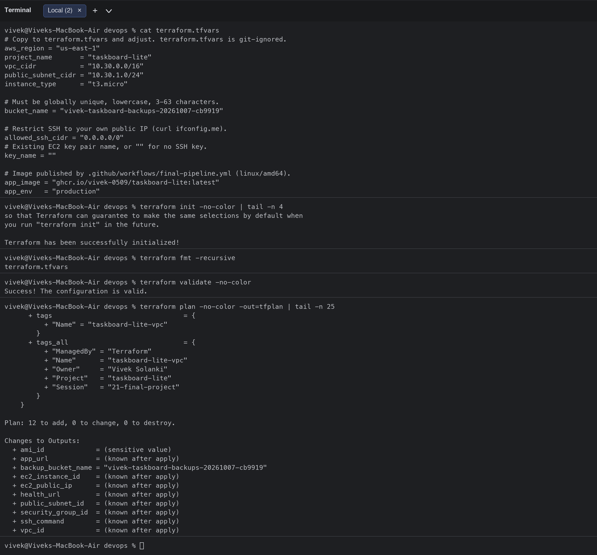
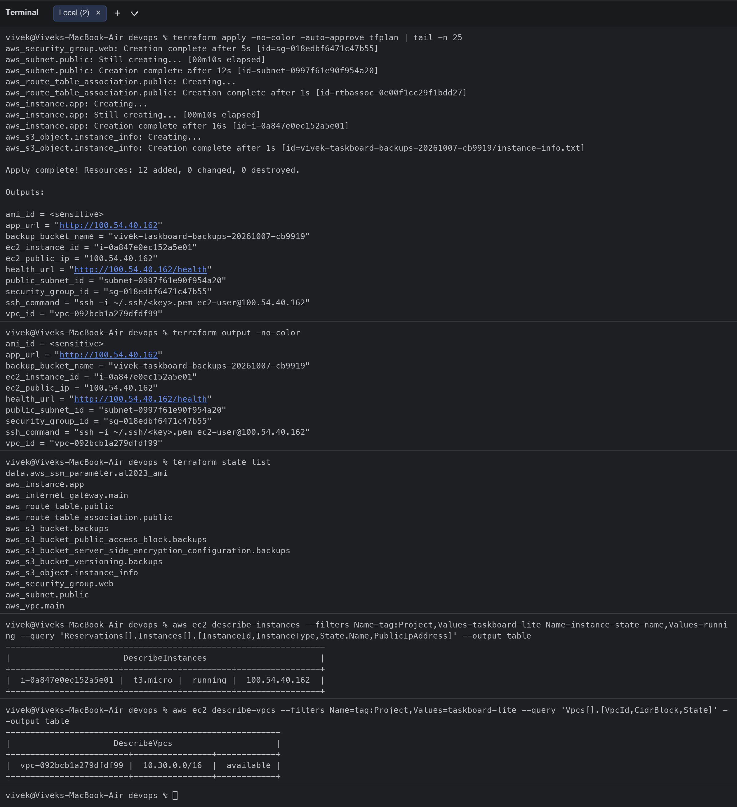
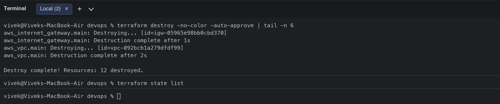

Note: the EC2 user_data pulls `ghcr.io/vivek-0509/taskboard-lite:<commit-sha>` (the tag is the Git commit SHA); the image becomes pullable once the pipeline has pushed it to GHCR after the first push to `main`.

## 10. CI/CD pipeline

Workflow: [.github/workflows/final-pipeline.yml](../.github/workflows/final-pipeline.yml).

```text
test -> sast -> sca -> secret-scan -> docker-build -> image-scan -> security-gate -> push-image (main only) -> deploy-kubernetes (kind + helm)
```

- `test`: pytest with coverage, JUnit/coverage artifacts
- `docker-build`: builds `ghcr.io/vivek-0509/taskboard-lite:<commit-sha>` (tag = Git commit SHA) and saves it as an artifact for the scan and deploy jobs
- `push-image`: logs in to GHCR with `GITHUB_TOKEN` and pushes the SHA tag + `latest` (only on push to `main`)
- `deploy-kubernetes`: creates a kind cluster on the runner, loads the image, `helm upgrade --install`, waits for the rollout and smoke-tests `/health`, `/ready`, `/api/tasks`

Local execution of the pipeline with `act` (pull_request event, so push/deploy are skipped like on a PR):

```bash
$ act -W .github/workflows/session21-final-pipeline.yml --list
Stage  Job ID             Job name                            Workflow name          Workflow file                 Events                
0      test               Unit tests (pytest)                 Final DevOps Pipeline  session21-final-pipeline.yml  push,workflow_dispatch
1      sast               SAST (bandit)                       Final DevOps Pipeline  session21-final-pipeline.yml  push,workflow_dispatch
2      sca                SCA (pip-audit)                     Final DevOps Pipeline  session21-final-pipeline.yml  push,workflow_dispatch
3      secret-scan        Secret scanning (gitleaks)          Final DevOps Pipeline  session21-final-pipeline.yml  push,workflow_dispatch
4      docker-build       Build image                         Final DevOps Pipeline  session21-final-pipeline.yml  push,workflow_dispatch
5      image-scan         Image scan (trivy)                  Final DevOps Pipeline  session21-final-pipeline.yml  push,workflow_dispatch
6      security-gate      Security gate                       Final DevOps Pipeline  session21-final-pipeline.yml  workflow_dispatch,push
7      push-image         Push image to GHCR                  Final DevOps Pipeline  session21-final-pipeline.yml  push,workflow_dispatch
8      deploy-kubernetes  Deploy to Kubernetes (kind + helm)  Final DevOps Pipeline  session21-final-pipeline.yml  push,workflow_dispatch
$ act pull_request -P ubuntu-latest=catthehacker/ubuntu:act-latest --container-architecture linux/arm64 --container-daemon-socket unix:///var/run/docker.sock -W .github/workflows/session21-final-pipeline.yml --artifact-server-path .act-artifacts/s21 -j security-gate 2>&1 | sed -E 's/\[[0-9;]*m//g' | grep -vE 'not located inside a git repository|unable to get git (ref|revision)'
[Final DevOps Pipeline/Unit tests (pytest)] ⭐ Run Main Check out
[Final DevOps Pipeline/Unit tests (pytest)]   ✅  Success - Main Check out [559.711166ms]
[Final DevOps Pipeline/Unit tests (pytest)] ⭐ Run Main Python venv when running locally with act
[Final DevOps Pipeline/Unit tests (pytest)]   ✅  Success - Main Python venv when running locally with act [3.685582416s]
[Final DevOps Pipeline/Unit tests (pytest)] ⭐ Run Main Install dependencies
[Final DevOps Pipeline/Unit tests (pytest)]   ✅  Success - Main Install dependencies [12.26086075s]
[Final DevOps Pipeline/Unit tests (pytest)] ⭐ Run Main Run pytest with coverage
[Final DevOps Pipeline/Unit tests (pytest)]   ✅  Success - Main Run pytest with coverage [922.437292ms]
[Final DevOps Pipeline/Unit tests (pytest)] ⭐ Run Main Upload test results
[Final DevOps Pipeline/Unit tests (pytest)]   ✅  Success - Main Upload test results [727.06175ms]
[Final DevOps Pipeline/Unit tests (pytest)] 🏁  Job succeeded
[Final DevOps Pipeline/SAST (bandit)      ] ⭐ Run Main Check out
[Final DevOps Pipeline/SAST (bandit)      ]   ✅  Success - Main Check out [686.73425ms]
[Final DevOps Pipeline/SAST (bandit)      ] ⭐ Run Main Python venv when running locally with act
[Final DevOps Pipeline/SAST (bandit)      ]   ✅  Success - Main Python venv when running locally with act [2.701465667s]
[Final DevOps Pipeline/SAST (bandit)      ] ⭐ Run Main Install bandit
[Final DevOps Pipeline/SAST (bandit)      ]   ✅  Success - Main Install bandit [3.763659167s]
[Final DevOps Pipeline/SAST (bandit)      ] ⭐ Run Main Run bandit (JSON report, all severities)
[Final DevOps Pipeline/SAST (bandit)      ]   ✅  Success - Main Run bandit (JSON report, all severities) [215.991833ms]
[Final DevOps Pipeline/SAST (bandit)      ] ⭐ Run Main Upload bandit report
[Final DevOps Pipeline/SAST (bandit)      ]   ✅  Success - Main Upload bandit report [525.752125ms]
[Final DevOps Pipeline/SAST (bandit)      ] ⭐ Run Main Fail on HIGH severity findings
[Final DevOps Pipeline/SAST (bandit)      ]   ✅  Success - Main Fail on HIGH severity findings [77.068583ms]
[Final DevOps Pipeline/SAST (bandit)      ] 🏁  Job succeeded
[Final DevOps Pipeline/SCA (pip-audit)    ] ⭐ Run Main Check out
[Final DevOps Pipeline/SCA (pip-audit)    ]   ✅  Success - Main Check out [671.12975ms]
[Final DevOps Pipeline/SCA (pip-audit)    ] ⭐ Run Main Python venv when running locally with act
[Final DevOps Pipeline/SCA (pip-audit)    ]   ✅  Success - Main Python venv when running locally with act [2.608357709s]
[Final DevOps Pipeline/SCA (pip-audit)    ] ⭐ Run Main Install pip-audit
[Final DevOps Pipeline/SCA (pip-audit)    ]   ✅  Success - Main Install pip-audit [7.383873542s]
[Final DevOps Pipeline/SCA (pip-audit)    ] ⭐ Run Main Audit runtime dependencies (JSON report)
[Final DevOps Pipeline/SCA (pip-audit)    ]   ✅  Success - Main Audit runtime dependencies (JSON report) [9.191019708s]
[Final DevOps Pipeline/SCA (pip-audit)    ] ⭐ Run Main Upload pip-audit report
[Final DevOps Pipeline/SCA (pip-audit)    ]   ✅  Success - Main Upload pip-audit report [584.510125ms]
[Final DevOps Pipeline/SCA (pip-audit)    ] ⭐ Run Main Fail on known vulnerabilities
[Final DevOps Pipeline/SCA (pip-audit)    ]   ✅  Success - Main Fail on known vulnerabilities [5.700076125s]
[Final DevOps Pipeline/SCA (pip-audit)    ] 🏁  Job succeeded
[Final DevOps Pipeline/Secret scanning (gitleaks)] ⭐ Run Main Check out (full history so every commit is scanned)
[Final DevOps Pipeline/Secret scanning (gitleaks)]   ✅  Success - Main Check out (full history so every commit is scanned) [665.782917ms]
[Final DevOps Pipeline/Secret scanning (gitleaks)] ⭐ Run Main gitleaks (local act fallback, same rules)
[Final DevOps Pipeline/Secret scanning (gitleaks)]   ✅  Success - Main gitleaks (local act fallback, same rules) [481.405041ms]
[Final DevOps Pipeline/Secret scanning (gitleaks)] 🏁  Job succeeded
[Final DevOps Pipeline/Build image               ] ⭐ Run Main Check out
[Final DevOps Pipeline/Build image               ]   ✅  Success - Main Check out [368.969292ms]
[Final DevOps Pipeline/Build image               ] ⭐ Run Main Normalise image name (GHCR requires lowercase)
[Final DevOps Pipeline/Build image               ]   ✅  Success - Main Normalise image name (GHCR requires lowercase) [47.481958ms]
[Final DevOps Pipeline/Build image               ] ⭐ Run Main Build
[Final DevOps Pipeline/Build image               ]   ✅  Success - Main Build [3.361499792s]
[Final DevOps Pipeline/Build image               ] ⭐ Run Main Smoke test the container
[Final DevOps Pipeline/Build image               ]   ✅  Success - Main Smoke test the container [2.404679s]
[Final DevOps Pipeline/Build image               ] ⭐ Run Main Save image
[Final DevOps Pipeline/Build image               ]   ✅  Success - Main Save image [340.628792ms]
[Final DevOps Pipeline/Build image               ] ⭐ Run Main Upload image artifact
[Final DevOps Pipeline/Build image               ]   ✅  Success - Main Upload image artifact [1.488718708s]
[Final DevOps Pipeline/Build image               ] 🏁  Job succeeded
[Final DevOps Pipeline/Image scan (trivy)        ] ⭐ Run Main Check out
[Final DevOps Pipeline/Image scan (trivy)        ]   ✅  Success - Main Check out [671.733125ms]
[Final DevOps Pipeline/Image scan (trivy)        ] ⭐ Run Main Normalise image name
[Final DevOps Pipeline/Image scan (trivy)        ]   ✅  Success - Main Normalise image name [64.758583ms]
[Final DevOps Pipeline/Image scan (trivy)        ] ⭐ Run Main Download image artifact
[Final DevOps Pipeline/Image scan (trivy)        ]   ✅  Success - Main Download image artifact [886.032416ms]
[Final DevOps Pipeline/Image scan (trivy)        ] ⭐ Run Main Load image
[Final DevOps Pipeline/Image scan (trivy)        ]   ✅  Success - Main Load image [307.931667ms]
[Final DevOps Pipeline/Image scan (trivy)        ] ⭐ Run Main Trivy scan (local act fallback, same settings via the Trivy container)
[Final DevOps Pipeline/Image scan (trivy)        ]   ✅  Success - Main Trivy scan (local act fallback, same settings via the Trivy container) [1m3.349241083s]
[Final DevOps Pipeline/Image scan (trivy)        ] 🏁  Job succeeded
[Final DevOps Pipeline/Security gate             ] ⭐ Run Main Summarise results
[Final DevOps Pipeline/Security gate             ]   ✅  Success - Main Summarise results [47.428ms]
[Final DevOps Pipeline/Security gate             ] ⭐ Run Main Block the pipeline if any stage did not succeed
[Final DevOps Pipeline/Security gate             ]   ✅  Success - Main Block the pipeline if any stage did not succeed [44.957583ms]
[Final DevOps Pipeline/Security gate             ] 🏁  Job succeeded│ ghcr.io/nektos/taskboard-lite:local (alpine 3.24.2)                              │   alpine   │        0        │
```
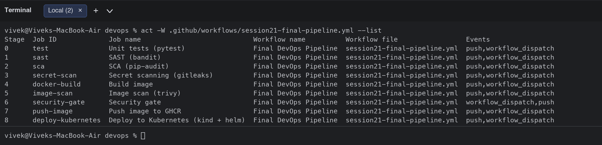
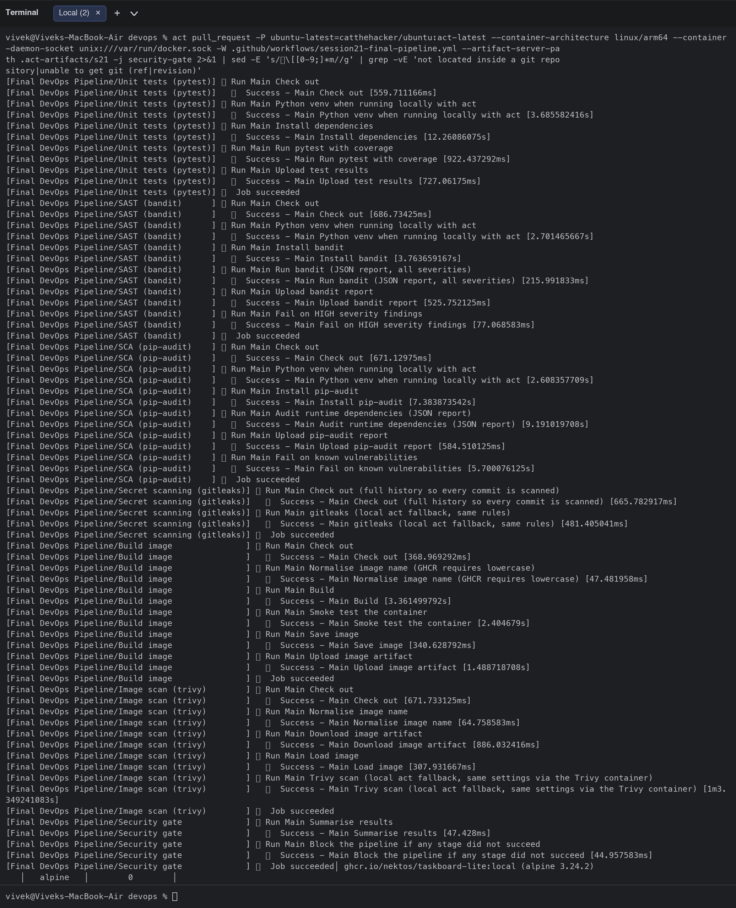

## 11. DevSecOps implementation

| Control | Tool / config | Result |
|---|---|---|
| SAST | Bandit, [security/bandit.yaml](../security/bandit.yaml); CodeQL on GitHub | 0 findings (one accepted B104 with inline justification) |
| SCA | pip-audit `--strict` on `application/requirements.txt` | 0 known vulnerabilities (Flask pinned to 3.1.3, the 3.1.1 CVE found in Session 17 was fixed) |
| Secret scanning | gitleaks, [security/.gitleaks.toml](../security/.gitleaks.toml) | no leaks |
| Container image scanning | Trivy, [security/trivy.yaml](../security/trivy.yaml), HIGH/CRITICAL, ignore-unfixed | 0 HIGH / 0 CRITICAL after moving to the Alpine base |
| Security gate | `security-gate` job (`if: always()`, checks every scan result) | blocks `push-image` and `deploy-kubernetes` if any scan fails |

```bash
$ bandit -r application -c security/bandit.yaml -f txt --severity-level medium; echo "bandit exit code: $?"
[main]	INFO	profile include tests: None
[main]	INFO	profile exclude tests: B101
[main]	INFO	cli include tests: None
[main]	INFO	cli exclude tests: None
[main]	INFO	using config: security/bandit.yaml
[main]	INFO	running on Python 3.13.7
Run started:2026-10-07 09:23:16.738035

Test results:
	No issues identified.

Code scanned:
	Total lines of code: 388
	Total lines skipped (#nosec): 0
	Total potential issues skipped due to specifically being disabled (e.g., #nosec BXXX): 1

Run metrics:
	Total issues (by severity):
		Undefined: 0
		Low: 0
		Medium: 0
		High: 0
	Total issues (by confidence):
		Undefined: 0
		Low: 0
		Medium: 0
		High: 0
Files skipped (0):
bandit exit code: 0
$ pip-audit -r application/requirements.txt --strict; echo "pip-audit exit code: $?"
No known vulnerabilities found
pip-audit exit code: 0
$ gitleaks dir . -c security/.gitleaks.toml --no-banner; echo "gitleaks exit code: $?"
2:53PM INF scanned ~189052 bytes (189.05 KB) in 24.4ms
2:53PM INF no leaks found
gitleaks exit code: 0
```
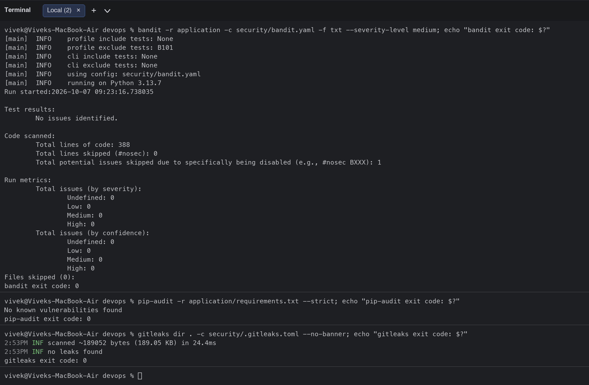

See [security/README.md](../security/README.md) for how each tool is run and how the gate works.

## 12. Monitoring

- `/health` (liveness), `/ready` (readiness, checks SQLite) and `/metrics` (Prometheus: `taskboard_requests_total`, `taskboard_tasks_created_total`, `taskboard_tasks_open`) are built into the app.
- docker compose runs Prometheus (scrapes the app) and Grafana (provisioned datasource + dashboard [monitoring/grafana/provisioning/dashboards/taskboard.json](../monitoring/grafana/provisioning/dashboards/taskboard.json)); [monitoring/alerts.yml](../monitoring/alerts.yml) defines `TaskboardDown` / error-rate alerts.
- On Kubernetes, [monitoring/servicemonitor.yaml](../monitoring/servicemonitor.yaml) and [monitoring/prometheus-rules.yaml](../monitoring/prometheus-rules.yaml) plug the app into kube-prometheus-stack; `kubectl top` (metrics-server) feeds the HPA.

Prometheus targets | Grafana dashboard
---|---
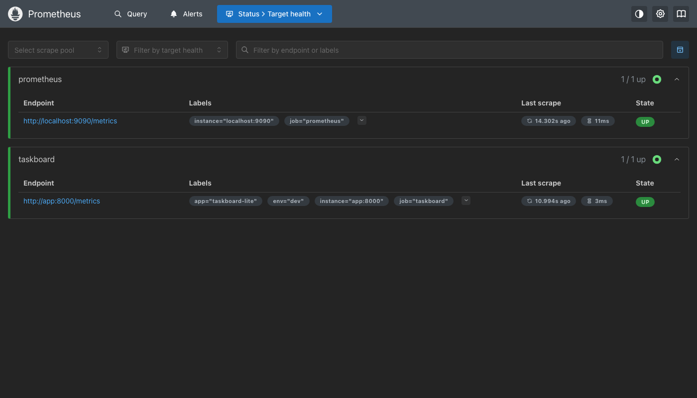 | 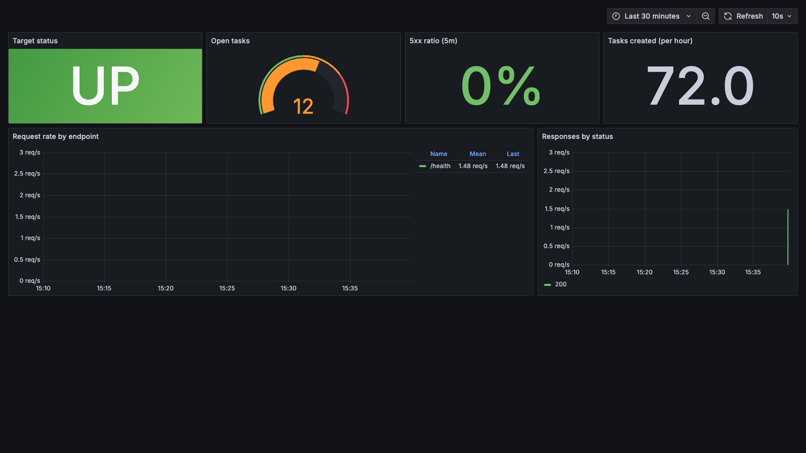

HPA under load (2 -> 4 replicas), `kubectl top`, metrics endpoint:

```bash
$ cat gitops/argocd-application.yaml
# Argo CD Application: the cluster continuously reconciles the taskboard
# namespace with gitops/manifests in the main branch of this repository.
#
#   kubectl create namespace argocd
#   kubectl apply -n argocd -f https://raw.githubusercontent.com/argoproj/argo-cd/stable/manifests/install.yaml
#   kubectl -n argocd patch cm argocd-cm --type merge \
#   kubectl apply -f gitops/argocd-application.yaml
apiVersion: argoproj.io/v1alpha1
kind: Application
metadata:
  name: taskboard-lite
  namespace: argocd
  labels:
    app.kubernetes.io/name: taskboard-lite
    app.kubernetes.io/part-of: taskboard-lite
  finalizers:
    # Deleting the Application also deletes the resources it created.
    - resources-finalizer.argocd.argoproj.io
spec:
  project: default
  source:
    repoURL: https://github.com/vivek-0509/Devops_Final_Assignment_N_Project.git
    targetRevision: main
    path: session-21-final-devops-project/final-devops-project/gitops/manifests
  destination:
    server: https://kubernetes.default.svc
    namespace: taskboard
  syncPolicy:
    automated:
      prune: true     # delete resources that were removed from git
      selfHeal: true  # revert manual kubectl changes back to the git state
    syncOptions:
      - CreateNamespace=true
      - PruneLast=true
    retry:
      limit: 3
      backoff:
        duration: 10s
        factor: 2
        maxDuration: 2m
$ kubectl kustomize gitops/manifests | grep -E "^kind:|^  name:" | paste - - 
kind: Namespace	  name: taskboard
kind: ConfigMap	  name: taskboard-config
kind: Secret	  name: taskboard-secret
kind: Service	  name: taskboard-lite
kind: PersistentVolumeClaim	  name: taskboard-data
kind: Deployment	  name: taskboard-lite
kind: HorizontalPodAutoscaler	  name: taskboard-lite
$ kubectl kustomize gitops/manifests | kubectl apply --dry-run=server -f - 
Warning: resource namespaces/taskboard is missing the kubectl.kubernetes.io/last-applied-configuration annotation which is required by kubectl apply. kubectl apply should only be used on resources created declaratively by either kubectl create --save-config or kubectl apply. The missing annotation will be patched automatically.
namespace/taskboard configured (server dry run)
configmap/taskboard-config created (server dry run)
secret/taskboard-secret created (server dry run)
Warning: resource services/taskboard-lite is missing the kubectl.kubernetes.io/last-applied-configuration annotation which is required by kubectl apply. kubectl apply should only be used on resources created declaratively by either kubectl create --save-config or kubectl apply. The missing annotation will be patched automatically.
service/taskboard-lite configured (server dry run)
persistentvolumeclaim/taskboard-data created (server dry run)
Warning: resource deployments/taskboard-lite is missing the kubectl.kubernetes.io/last-applied-configuration annotation which is required by kubectl apply. kubectl apply should only be used on resources created declaratively by either kubectl create --save-config or kubectl apply. The missing annotation will be patched automatically.
deployment.apps/taskboard-lite configured (server dry run)
Warning: resource horizontalpodautoscalers/taskboard-lite is missing the kubectl.kubernetes.io/last-applied-configuration annotation which is required by kubectl apply. kubectl apply should only be used on resources created declaratively by either kubectl create --save-config or kubectl apply. The missing annotation will be patched automatically.
horizontalpodautoscaler.autoscaling/taskboard-lite configured (server dry run)
$ cat monitoring/servicemonitor.yaml | grep -vE "^\s*#|^\s*$"
apiVersion: monitoring.coreos.com/v1
kind: ServiceMonitor
metadata:
  name: taskboard-lite
  namespace: taskboard
  labels:
    app.kubernetes.io/name: taskboard-lite
    app.kubernetes.io/part-of: taskboard-lite
    release: kube-prometheus-stack
spec:
  namespaceSelector:
    matchNames:
      - taskboard
  selector:
    matchLabels:
      app.kubernetes.io/name: taskboard-lite
  endpoints:
    - port: http
      path: /metrics
      interval: 15s
      scrapeTimeout: 5s
$ kubectl top pods -n taskboard
NAME                              CPU(cores)   MEMORY(bytes)   
taskboard-lite-64667854f7-bdg6m   2m           33Mi            
taskboard-lite-64667854f7-p2jgr   2m           40Mi            
$ kubectl get hpa -n taskboard
NAME             REFERENCE                   TARGETS       MINPODS   MAXPODS   REPLICAS   AGE
taskboard-lite   Deployment/taskboard-lite   cpu: 4%/60%   2         5         2          11m
# --- short load test to exercise the HPA (3 busybox loops for 90 s) ---
$ kubectl run load-1 -n taskboard --image=busybox:1.36 --restart=Never -- sh -c 'while true; do wget -q -O- http://taskboard-lite/api/tasks >/dev/null 2>&1; done'
pod/load-1 created
$ kubectl run load-2 -n taskboard --image=busybox:1.36 --restart=Never -- sh -c 'while true; do wget -q -O- http://taskboard-lite/api/tasks/stats >/dev/null 2>&1; done'
pod/load-2 created
$ kubectl run load-3 -n taskboard --image=busybox:1.36 --restart=Never -- sh -c 'while true; do wget -q -O- http://taskboard-lite/metrics >/dev/null 2>&1; done'
pod/load-3 created
$ kubectl get hpa -n taskboard
NAME             REFERENCE                   TARGETS       MINPODS   MAXPODS   REPLICAS   AGE
taskboard-lite   Deployment/taskboard-lite   cpu: 4%/60%   2         5         2          12m
$ kubectl top pods -n taskboard -l app.kubernetes.io/name=taskboard-lite
NAME                              CPU(cores)   MEMORY(bytes)   
taskboard-lite-64667854f7-bdg6m   52m          33Mi            
taskboard-lite-64667854f7-p2jgr   67m          42Mi            
$ kubectl get hpa -n taskboard
NAME             REFERENCE                   TARGETS         MINPODS   MAXPODS   REPLICAS   AGE
taskboard-lite   Deployment/taskboard-lite   cpu: 119%/60%   2         5         4          12m
$ kubectl top pods -n taskboard -l app.kubernetes.io/name=taskboard-lite
NAME                              CPU(cores)   MEMORY(bytes)   
taskboard-lite-64667854f7-bdg6m   52m          33Mi            
taskboard-lite-64667854f7-p2jgr   67m          42Mi            
$ kubectl get hpa -n taskboard
NAME             REFERENCE                   TARGETS         MINPODS   MAXPODS   REPLICAS   AGE
taskboard-lite   Deployment/taskboard-lite   cpu: 119%/60%   2         5         4          13m
$ kubectl top pods -n taskboard -l app.kubernetes.io/name=taskboard-lite
NAME                              CPU(cores)   MEMORY(bytes)   
taskboard-lite-64667854f7-bdg6m   187m         35Mi            
taskboard-lite-64667854f7-bgh6j   176m         35Mi            
taskboard-lite-64667854f7-p2jgr   183m         42Mi            
taskboard-lite-64667854f7-w5xl6   182m         35Mi            
$ kubectl get pods -n taskboard -l app.kubernetes.io/name=taskboard-lite
NAME                              READY   STATUS    RESTARTS   AGE
taskboard-lite-64667854f7-bdg6m   1/1     Running   0          13m
taskboard-lite-64667854f7-bgh6j   1/1     Running   0          54s
taskboard-lite-64667854f7-p2jgr   1/1     Running   0          13m
taskboard-lite-64667854f7-w5xl6   1/1     Running   0          54s
$ kubectl delete pod load-1 load-2 load-3 -n taskboard
pod "load-1" deleted from taskboard namespace
pod "load-2" deleted from taskboard namespace
pod "load-3" deleted from taskboard namespace
$ kubectl describe hpa taskboard-lite -n taskboard | grep -A 6 "^Events" | tail -n 4
  Normal   SuccessfulRescale             13m                horizontal-pod-autoscaler  New size: 2; reason: Current number of replicas below Spec.MinReplicas
  Warning  FailedGetResourceMetric       13m                horizontal-pod-autoscaler  failed to get cpu utilization: unable to get metrics for resource cpu: no metrics returned from resource metrics API
  Warning  FailedComputeMetricsReplicas  13m                horizontal-pod-autoscaler  invalid metrics (1 invalid out of 1), first error is: failed to get cpu resource metric value: failed to get cpu utilization: unable to get metrics for resource cpu: no metrics returned from resource metrics API
  Warning  FailedGetResourceMetric       12m (x4 over 13m)  horizontal-pod-autoscaler  failed to get cpu utilization: did not receive metrics for targeted pods (pods might be unready)
$ colima ssh -- curl -s --resolve taskboard.local:80:192.168.49.2 http://taskboard.local/metrics | grep -E '^taskboard_requests_total' | head -n 6
taskboard_requests_total{endpoint="/health",method="GET",status="200"} 9.0
taskboard_requests_total{endpoint="/ready",method="GET",status="200"} 17.0
taskboard_requests_total{endpoint="/api/tasks/stats",method="GET",status="200"} 6639.0
taskboard_requests_total{endpoint="/api/tasks",method="GET",status="200"} 6455.0
taskboard_requests_total{endpoint="/metrics",method="GET",status="200"} 5456.0
```
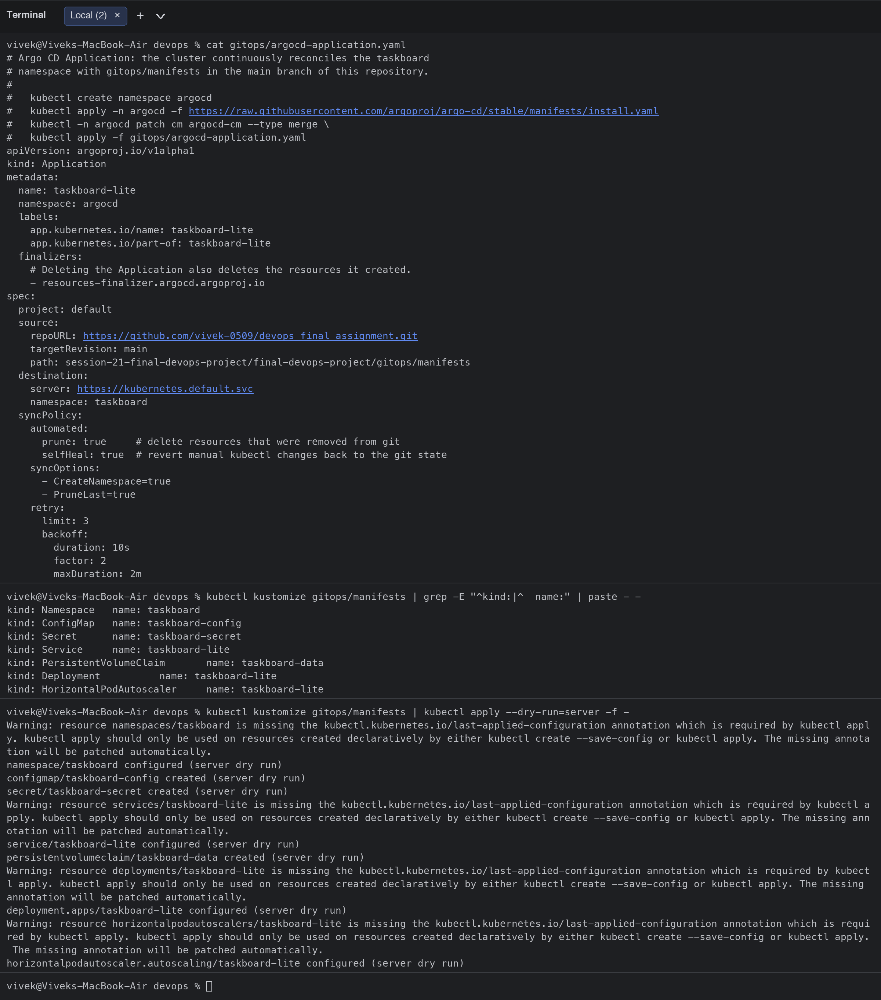
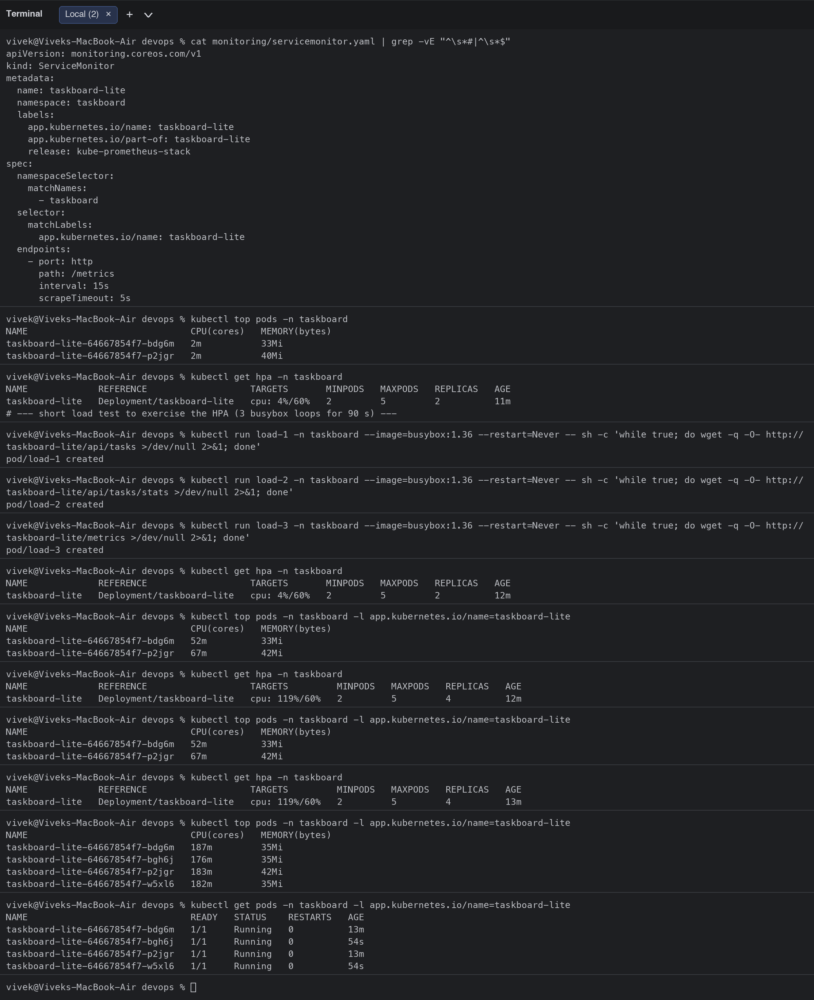
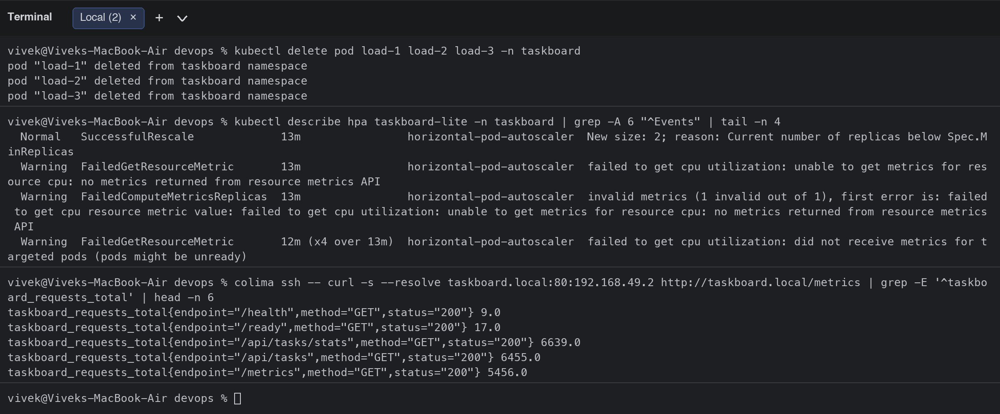

## 13. GitOps

[gitops/argocd-application.yaml](../gitops/argocd-application.yaml) declares an Argo CD `Application` that watches `gitops/manifests` (kustomize) in this repository with automated sync, prune and self-heal; `kubectl kustomize gitops/manifests` renders exactly the Kubernetes objects deployed above (verified with a server-side dry run in the output above). The Argo CD mechanics (install, sync, drift repaired by self-heal) were demonstrated end-to-end in Session 20 of the course; once this repository is pushed, applying the Application manifest makes Argo CD deploy the `taskboard` namespace from Git. See [gitops/README.md](../gitops/README.md) for the workflow (PR -> merge -> reconcile, image tag bump by CI).

## 14. Troubleshooting challenge

Four issues were introduced on purpose ([troubleshooting/](../troubleshooting/)) and resolved with the standard loop: identify -> investigate (`kubectl get/describe/logs/endpoints`) -> root cause -> fix -> verify.

| # | Symptom | Root cause | Fix |
|---|---|---|---|
| 1 | `ImagePullBackOff` | image tag `taskboard-lite:v9.9.9` does not exist | `kubectl set image ... taskboard-lite:local` (in CI: correct SHA tag) |
| 2 | Service has `<none>` endpoints, requests fail | Service selector `instance: scenario-2` does not match the Pod label `scenario-02` | patch the selector |
| 3 | `CreateContainerConfigError` | container references key `DB_PASS`, the Secret only has `DB_PASSWORD` | patch the `secretKeyRef.key` |
| 4 | Pods never Ready, Ingress returns 503 | readiness probe path `/readyz` instead of `/ready` | patch the probe path |

```bash
# The scenarios reference the plain-manifest ConfigMap/Secret names (taskboard-config / taskboard-secret)
$ kubectl apply -f kubernetes/configmap.yaml -f kubernetes/secret.yaml
configmap/taskboard-config created
secret/taskboard-secret created
# ===== Scenario 01: wrong image tag =====
$ kubectl apply -f troubleshooting/01-broken-image.yaml
deployment.apps/taskboard-broken-image created
$ kubectl get pods -n taskboard -l app.kubernetes.io/instance=scenario-01
NAME                                      READY   STATUS             RESTARTS   AGE
taskboard-broken-image-6f4844b95c-lndl6   0/1     ImagePullBackOff   0          21s
$ kubectl describe pod -n taskboard -l app.kubernetes.io/instance=scenario-01 | grep -A 8 "^Events" | grep -E "Failed|BackOff" | head -n 3
  Normal   BackOff    17s               kubelet            spec.containers{taskboard-lite}: Back-off pulling image "taskboard-lite:v9.9.9"
  Warning  Failed     17s               kubelet            spec.containers{taskboard-lite}: Error: ImagePullBackOff
  Warning  Failed     5s (x2 over 18s)  kubelet            spec.containers{taskboard-lite}: Failed to pull image "taskboard-lite:v9.9.9": failed to pull and unpack image "docker.io/library/taskboard-lite:v9.9.9": failed to resolve reference "docker.io/library/taskboard-lite:v9.9.9": pull access denied, repository does not exist or may require authorization: server message: insufficient_scope: authorization failed
$ kubectl get deployment taskboard-broken-image -n taskboard -o jsonpath="{.spec.template.spec.containers[0].image}"; echo
taskboard-lite:v9.9.9
$ kubectl -n taskboard set image deployment/taskboard-broken-image taskboard-lite=taskboard-lite:local
deployment.apps/taskboard-broken-image image updated
$ kubectl rollout status deployment/taskboard-broken-image -n taskboard --timeout=120s
Waiting for deployment "taskboard-broken-image" rollout to finish: 1 old replicas are pending termination...
Waiting for deployment "taskboard-broken-image" rollout to finish: 1 old replicas are pending termination...
Waiting for deployment "taskboard-broken-image" rollout to finish: 1 old replicas are pending termination...
deployment "taskboard-broken-image" successfully rolled out
$ kubectl get pods -n taskboard -l app.kubernetes.io/instance=scenario-01
NAME                                      READY   STATUS        RESTARTS   AGE
taskboard-broken-image-54c5df496c-sh25z   1/1     Running       0          11s
taskboard-broken-image-6f4844b95c-lndl6   0/1     Terminating   0          32s
$ kubectl delete -f troubleshooting/01-broken-image.yaml
deployment.apps "taskboard-broken-image" deleted from taskboard namespace
# ===== Scenario 02: Service selector mismatch =====
$ kubectl apply -f troubleshooting/02-broken-service.yaml
deployment.apps/taskboard-broken-selector created
service/taskboard-broken-selector created
$ kubectl rollout status deployment/taskboard-broken-selector -n taskboard --timeout=120s
Waiting for deployment "taskboard-broken-selector" rollout to finish: 0 of 1 updated replicas are available...
deployment "taskboard-broken-selector" successfully rolled out
$ kubectl get endpoints taskboard-broken-selector -n taskboard
Warning: v1 Endpoints is deprecated in v1.33+; use discovery.k8s.io/v1 EndpointSlice
NAME                        ENDPOINTS   AGE
taskboard-broken-selector   <none>      11s
$ kubectl run curl-02 -n taskboard --image=curlimages/curl:8.5.0 --rm -i --restart=Never -- curl -s --max-time 5 http://taskboard-broken-selector/health || echo "request FAILED (no endpoints)"
All commands and output from this session will be recorded in container logs, including credentials and sensitive information passed through the command prompt.
If you don't see a command prompt, try pressing enter.
warning: couldn't attach to pod/curl-02, falling back to streaming logs: unable to upgrade connection: container curl-02 not found in pod curl-02_taskboard
pod "curl-02" deleted from taskboard namespace
pod taskboard/curl-02 terminated (Error)
request FAILED (no endpoints)
$ kubectl get pods -n taskboard -l app.kubernetes.io/instance=scenario-02 --show-labels
NAME                                        READY   STATUS    RESTARTS   AGE   LABELS
taskboard-broken-selector-db4896d76-b9rcm   1/1     Running   0          13s   app.kubernetes.io/instance=scenario-02,app.kubernetes.io/name=taskboard-lite-broken,app.kubernetes.io/part-of=taskboard-lite,pod-template-hash=db4896d76
$ kubectl get svc taskboard-broken-selector -n taskboard -o jsonpath="{.spec.selector}"; echo
{"app.kubernetes.io/instance":"scenario-2","app.kubernetes.io/name":"taskboard-lite-broken"}
$ kubectl -n taskboard patch svc taskboard-broken-selector -p "{\"spec\":{\"selector\":{\"app.kubernetes.io/name\":\"taskboard-lite-broken\",\"app.kubernetes.io/instance\":\"scenario-02\"}}}"
service/taskboard-broken-selector patched
$ kubectl get endpoints taskboard-broken-selector -n taskboard
Warning: v1 Endpoints is deprecated in v1.33+; use discovery.k8s.io/v1 EndpointSlice
NAME                        ENDPOINTS          AGE
taskboard-broken-selector   10.244.0.38:8000   16s
$ kubectl run curl-02 -n taskboard --image=curlimages/curl:8.5.0 --rm -i --restart=Never -- curl -s --max-time 5 http://taskboard-broken-selector/health
{"status":"ok"}
All commands and output from this session will be recorded in container logs, including credentials and sensitive information passed through the command prompt.
If you don't see a command prompt, try pressing enter.
warning: couldn't attach to pod/curl-02, falling back to streaming logs: Internal error occurred: Internal error occurred: error attaching to container: container is in CONTAINER_EXITED state
{"status":"ok"}
pod "curl-02" deleted from taskboard namespace
$ kubectl delete -f troubleshooting/02-broken-service.yaml
deployment.apps "taskboard-broken-selector" deleted from taskboard namespace
service "taskboard-broken-selector" deleted from taskboard namespace
# ===== Scenario 03: missing Secret key =====
$ kubectl apply -f troubleshooting/03-broken-secret-ref.yaml
deployment.apps/taskboard-broken-secret created
$ kubectl get pods -n taskboard -l app.kubernetes.io/instance=scenario-03
NAME                                       READY   STATUS                       RESTARTS   AGE
taskboard-broken-secret-584cb84b77-l8gsw   0/1     CreateContainerConfigError   0          15s
$ kubectl describe pod -n taskboard -l app.kubernetes.io/instance=scenario-03 | grep -A 8 "^Events" | grep -iE "secret|Failed" | head -n 2
  Normal   Scheduled  15s               default-scheduler  Successfully assigned taskboard/taskboard-broken-secret-584cb84b77-l8gsw to minikube
  Warning  Failed     0s (x3 over 15s)  kubelet            spec.containers{taskboard-lite}: Error: couldn't find key DB_PASS in Secret taskboard/taskboard-secret
$ kubectl get secret taskboard-secret -n taskboard -o jsonpath="{.data}" | jq "keys"
[
  "DB_PASSWORD"
]
$ kubectl get deployment taskboard-broken-secret -n taskboard -o jsonpath="{.spec.template.spec.containers[0].env[0]}"; echo
{"name":"DB_PASSWORD","valueFrom":{"secretKeyRef":{"key":"DB_PASS","name":"taskboard-secret"}}}
$ kubectl -n taskboard patch deployment taskboard-broken-secret --type json -p "[{\"op\":\"replace\",\"path\":\"/spec/template/spec/containers/0/env/0/valueFrom/secretKeyRef/key\",\"value\":\"DB_PASSWORD\"}]"
deployment.apps/taskboard-broken-secret patched
$ kubectl rollout status deployment/taskboard-broken-secret -n taskboard --timeout=120s
Waiting for deployment "taskboard-broken-secret" rollout to finish: 1 old replicas are pending termination...
Waiting for deployment "taskboard-broken-secret" rollout to finish: 1 old replicas are pending termination...
Waiting for deployment "taskboard-broken-secret" rollout to finish: 1 old replicas are pending termination...
deployment "taskboard-broken-secret" successfully rolled out
$ kubectl get pods -n taskboard -l app.kubernetes.io/instance=scenario-03
NAME                                       READY   STATUS        RESTARTS   AGE
taskboard-broken-secret-584cb84b77-l8gsw   0/1     Terminating   0          26s
taskboard-broken-secret-dfbff899c-6hzb2    1/1     Running       0          11s
$ kubectl delete -f troubleshooting/03-broken-secret-ref.yaml
deployment.apps "taskboard-broken-secret" deleted from taskboard namespace
# ===== Scenario 04: readiness probe on the wrong path =====
$ kubectl apply -f troubleshooting/04-broken-probe.yaml
deployment.apps/taskboard-broken-probe created
service/taskboard-broken-probe created
ingress.networking.k8s.io/taskboard-broken-probe created
$ kubectl get pods,svc,endpoints -n taskboard -l app.kubernetes.io/instance=scenario-04
Warning: v1 Endpoints is deprecated in v1.33+; use discovery.k8s.io/v1 EndpointSlice
NAME                                          READY   STATUS    RESTARTS   AGE
pod/taskboard-broken-probe-69d55cf9cb-29vgb   0/1     Running   0          36s

NAME                             TYPE        CLUSTER-IP      EXTERNAL-IP   PORT(S)   AGE
service/taskboard-broken-probe   ClusterIP   10.101.178.56   <none>        80/TCP    36s

NAME                               ENDPOINTS   AGE
endpoints/taskboard-broken-probe               36s
$ kubectl describe pod -n taskboard -l app.kubernetes.io/instance=scenario-04 | grep -E "Readiness:|Unhealthy" | head -n 3
    Readiness:  http-get http://:http/readyz delay=0s timeout=1s period=5s successThreshold=1 failureThreshold=3
  Warning  Unhealthy  35s (x2 over 35s)  kubelet            spec.containers{taskboard-lite}: Readiness probe failed: Get "http://10.244.0.43:8000/readyz": dial tcp 10.244.0.43:8000: connect: connection refused
  Warning  Unhealthy  5s (x6 over 30s)   kubelet            spec.containers{taskboard-lite}: Readiness probe failed: HTTP probe failed with statuscode: 404
$ kubectl -n taskboard patch deployment taskboard-broken-probe --type json -p "[{\"op\":\"replace\",\"path\":\"/spec/template/spec/containers/0/readinessProbe/httpGet/path\",\"value\":\"/ready\"}]"
deployment.apps/taskboard-broken-probe patched
$ kubectl rollout status deployment/taskboard-broken-probe -n taskboard --timeout=120s
Waiting for deployment "taskboard-broken-probe" rollout to finish: 1 old replicas are pending termination...
Waiting for deployment "taskboard-broken-probe" rollout to finish: 1 old replicas are pending termination...
Waiting for deployment "taskboard-broken-probe" rollout to finish: 1 old replicas are pending termination...
deployment "taskboard-broken-probe" successfully rolled out
$ kubectl get pods,endpoints -n taskboard -l app.kubernetes.io/instance=scenario-04
Warning: v1 Endpoints is deprecated in v1.33+; use discovery.k8s.io/v1 EndpointSlice
NAME                                          READY   STATUS        RESTARTS   AGE
pod/taskboard-broken-probe-69d55cf9cb-29vgb   0/1     Terminating   0          46s
pod/taskboard-broken-probe-d8bd456cd-dk7fp    1/1     Running       0          10s

NAME                               ENDPOINTS          AGE
endpoints/taskboard-broken-probe   10.244.0.44:8000   46s
$ kubectl delete -f troubleshooting/04-broken-probe.yaml
deployment.apps "taskboard-broken-probe" deleted from taskboard namespace
service "taskboard-broken-probe" deleted from taskboard namespace
ingress.networking.k8s.io "taskboard-broken-probe" deleted from taskboard namespace
$ kubectl delete -f kubernetes/configmap.yaml -f kubernetes/secret.yaml
configmap "taskboard-config" deleted from taskboard namespace
secret "taskboard-secret" deleted from taskboard namespace
$ kubectl get pods -n taskboard
NAME                                      READY   STATUS        RESTARTS   AGE
taskboard-broken-probe-69d55cf9cb-29vgb   0/1     Terminating   0          47s
taskboard-broken-probe-d8bd456cd-dk7fp    1/1     Terminating   0          11s
taskboard-lite-64667854f7-bdg6m           1/1     Running       0          10m
taskboard-lite-64667854f7-p2jgr           1/1     Running       0          10m
```
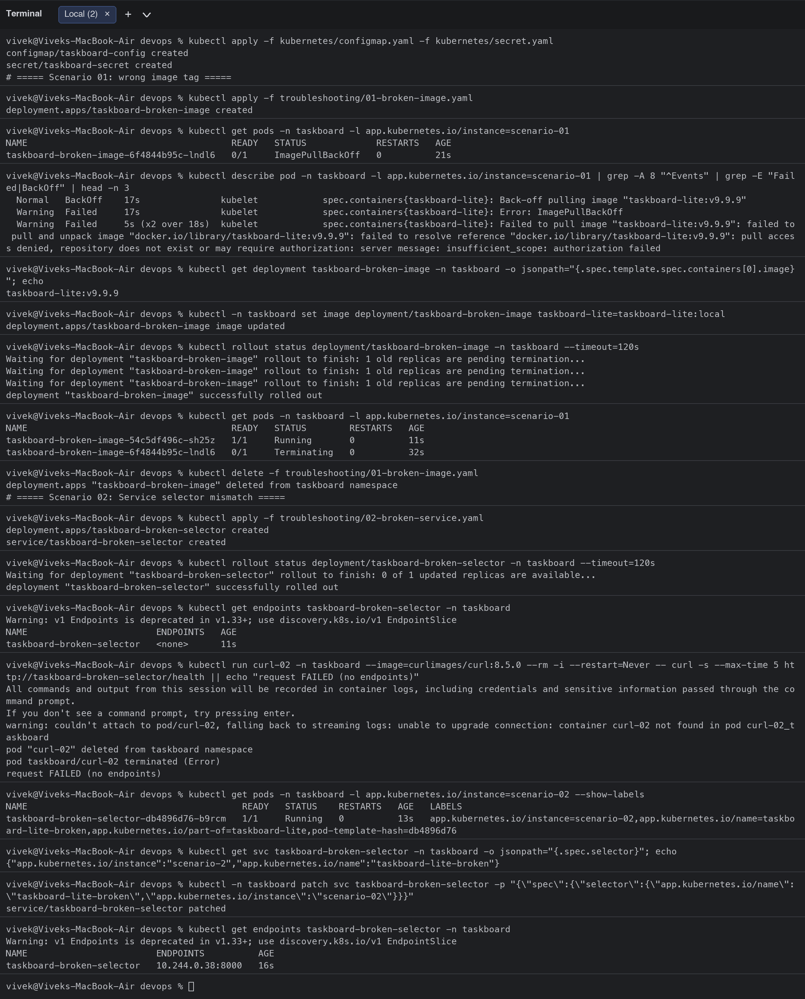
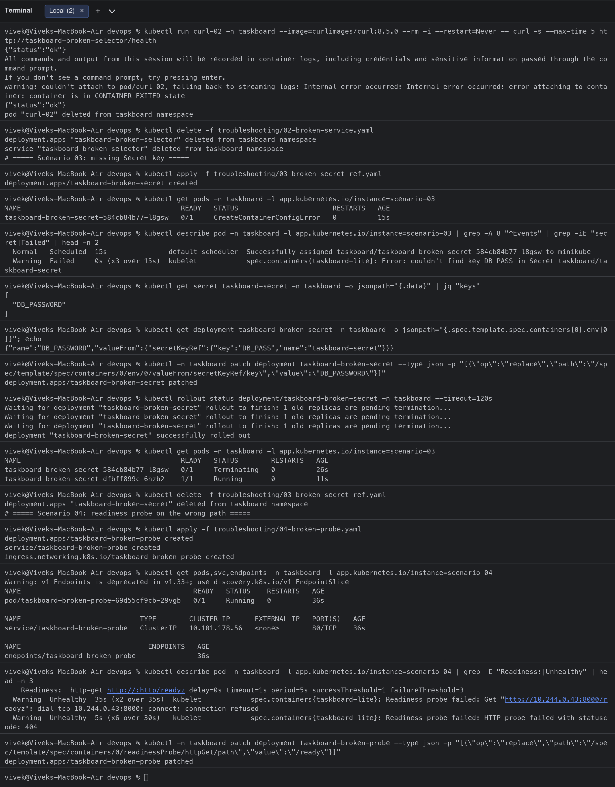
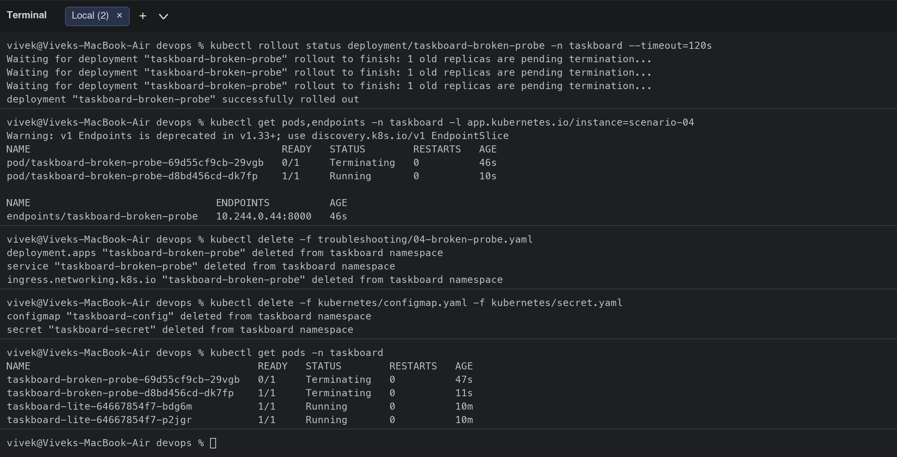

## 15. Screenshots
All terminal and browser screenshots are in [screenshots/](../screenshots/) (tests, security scans, Docker build + Trivy, docker compose, Terraform, Helm deploy, Kubernetes verification, troubleshooting, HPA/monitoring, app UI, Grafana, Prometheus).

## 16. Lessons learned
- A security gate is only useful if it actually blocks: both the dependency CVE (Flask) and the base-image CVEs (Debian util-linux) were real and had to be fixed before the pipeline could pass.
- Hardening has side effects: a read-only root filesystem broke gunicorn until `/tmp` got an `emptyDir`; `runAsNonRoot` requires the image to define the user.
- ReadWriteOnce storage forces the `Recreate` strategy (or a single replica) for stateful apps; for real multi-replica state a database should be used instead of SQLite on a PVC.
- Prometheus client counters are per process, so gunicorn runs with one worker (or needs multiprocess mode).
- `act` makes the pipeline testable before pushing, but GitHub-only actions (CodeQL, gitleaks-action, kind) need conditional steps.
- Terraform `plan` and `destroy` after every experiment kept the AWS bill at zero while still proving the infrastructure code works.

## Running it yourself

```bash
# tests
cd application && python3 -m venv .venv && source .venv/bin/activate && pip install -r requirements-dev.txt && pytest -v
# image + compose
docker build -f docker/Dockerfile -t taskboard-lite:local .
cd docker && mkdir -p data && docker compose up -d        # app :8000, Prometheus :9090, Grafana :3000
# kubernetes via helm (minikube with ingress + metrics-server addons)
minikube image load taskboard-lite:local
helm upgrade --install taskboard-lite helm/taskboard-lite -n taskboard --create-namespace
# terraform
cd terraform && cp terraform.tfvars.example terraform.tfvars && terraform init && terraform plan
```
